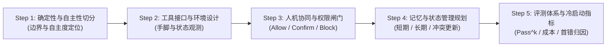

# 产品经理 Agent 实战与设计方法论：从认知通关到商业化落地

> **面向读者**：AI 产品经理（AI PM）、技术型产品负责人、创新业务架构师  
> **核心使命**：打破“把大模型当聊天框”、“只会提 Prompt 需求”、“Demo 惊艳上线被骂”的 PM 通病。以本项目（`Agent in Depth`）全景工程与实验资产为教具，建立起硬核的 **Agent 产品心智模型、边界定义方法与工业级落地 SOP**。

---

## 序言：AI PM 的第一性原理与心智重塑

作为 Agent 产品的 PM，你的第一个认知升级是：**不要再写“期望模型能准确理解用户意图并给出合适解答”这种无效 PRD。**

大模型在数学上是一个**无状态的概率接龙机器（Stateless Token Predictor）**。它没有物理世界常识，没有真正的因果逻辑，每次回答都伴随着随机性。

$$
\text{工业级 Agent 产品} = \underbrace{\text{大模型 (Model)}}_{\text{提供概率理解与发散推理}} + \underbrace{\text{工程底座 (Harness)}}_{\text{提供确定性边界、工具、状态与刹车}}
$$

* **普通聊天功能（ChatGPT 模式）**：单次开环嘴炮。问一句答一句，错了用户自己看，没有现实破坏力。
* **Agent 任务功能（自主代理模式）**：封闭闭环行动。替用户下发指令、改写配置、支付扣款、更新数据。一旦出错，伴随的是真实的业务资损与用户流失。

因此，**Agent 产品经理的核心职责，不是去微调模型的提示词，而是为非确定性的模型设计一套确定性的业务控制系统（Business Harness）**。

---

## 一、 PM 通关第一步：利用本项目建立工程防坑直觉

在动手画原型和写需求前，建议花 2~3 天借助本项目的实验和代码，建立起抗风险的工程直觉。

### 1. 牢记商业落地生死公式：$Pass@k$ vs $Pass^k$
研发常向你汇报：“我们测试了单步 Tool Calling 准确率高达 95%！”如果你以为产品能上线，就会掉进灾难：

$$
Pass^k = p^k
$$

| 单步准确率 ($p$) | 任务链步数 ($k$) | 用户端真实可用成功率 ($Pass^k$) | 商业产品评语 |
| :---: | :---: | :---: | :--- |
| 95% | 1 步 (简单问答) | **95.0%** | 体验良好 |
| 95% | 3 步 (查日历 $\to$ 定会议室 $\to$ 发通知) | **85.7%** | 偶尔报错，用户尚能容忍 |
| 95% | 7 步 (跨系统审批流、多工具联动) | **69.8%** | 每 3 个人里有 1 个人遭遇失败 |
| 95% | 15 步 (端到端数据分析报表闭环) | **46.3%** | **系统不可用（失败率过半）** |

> 💡 **PM 的产品决策法则**：
> 凡是长程链路（超过 5 步），**绝对不能把希望寄托在让模型自主一步步规划（Full ReAct）上**！必须在产品层拆解为**确定性的工作流（Workflow/State Machine）**，将大模型缩减在局部确定的小节点内，用工程底盘把整条链路的成功率兜住。

### 2. 警惕“线束税（Harness Tax）”对模型智商的稀释
* **现象**：业务方提了 50 条安全规则、30 个排版格式、40 个工具参数定义，PM 全部一股脑塞入 System Prompt（长达 8000 Tokens）。
* **代价**：不仅推理首字延迟（TTFT）飙升、成本暴涨，更致命的是**模型的注意力被严重稀释（Attention Dilution）**，模型开始“智商下降”，出现幻觉并频繁违背核心指令。
* **实操参考**：阅读 [`docs/architecture/OMP_VS_CLAUDE_CODE_COMPARISON.md`](docs/architecture/OMP_VS_CLAUDE_CODE_COMPARISON.md)，理解开源标杆如何通过“极简 4 原语”和“按需延迟加载技能（Deferred Skill Loading）”将线束税降到最低。

---

## 二、 PM 如何开展 Agent 产品设计：标准五步法



### 第一步：明确自主度边界（Autonomy Level）——拒绝盲目全自动
在 PRD 首页，必须用四档框架明确当前功能的自主度边界：

| 代理等级 | 交互模式 | 适用业务场景 | PM 设计关键点 |
| :--- | :--- | :--- | :--- |
| **L1: 辅助级 (Copilot)** | 意图识别 + 推荐槽位 | 邮件起草、SQL 自动补全 | 零副作用，用户不采纳就当没发生 |
| **L2: 建议执行级 (Human-in-the-loop)** | Agent 规划好步骤 $\to$ 弹出卡片由人确认 $\to$ 执行 | 日历预约、批量退款审批、生产配置修改 | 必须提供清晰的 Diff 呈现，确认后才生效 |
| **L3: 受限自主级 (Bounded Autonomous)** | 在沙箱或白名单内全自动，超纲触发审批 | 代码单测修复、特定报表跑批、只读数据探索 | 必须预设步数熔断（如最大 10 步）、预算熔断（Token 上限） |
| **L4: 完全自主级 (Fully Autonomous)** | 端到端黑盒自闭环 | 极度受限且环境可 100% 回滚的虚拟场景 | 需具备版本快照（Snapshot）与秒级环境重置（Rollback）能力 |

### 第二步：工具与动作空间设计（Action Space）
传统产品的 API 是给人或前端调用的；Agent 产品的工具是**给概率模型调用的**。

1. **命名即语义（Tool Semantic）**：
   - 错误示范：`executeAction(type=1, data={...})`（模型完全无法理解 `type=1` 的业务含义，必瞎填）；
   - 正确示范：`book_flight_ticket(departure_city, destination_city, date)`（动宾结构，字段语义清晰自解释）。
2. **零幻觉与槽位缺失保护**：
   - 在 PRD 中明确规定：当必要参数缺失（如用户只说“帮我寄快递”，没说地址），**底层严禁默认脑补假地址**，必须返回 `SLOT_MISSING`，引导 Agent 走单轮或多轮追问澄清交互。
3. **Observation 归一化设计**：
   - 工具报错时不要直接把系统崩溃堆栈丢给模型。PM 应与研发约定清晰的标准返回：
     ```json
     {
       "status": "FAILED",
       "error_code": "INSUFFICIENT_BALANCE",
       "user_friendly_hint": "账户余额不足 50 元，请提醒用户充值或更换支付方式"
     }
     ```
     **清晰的失败反馈是 Agent 自主纠错自愈的前提。**

### 第三步：人机协同与权限闸门（Permission Gates）
任何具备外部副作用（写入、更新、删除、外呼）的操作，在 PRD 中必须落实**三态安全决策**：

```
                      [ Agent 决策发起外部操作 ]
                                  │
                  ┌───────────────┴───────────────┐
                  ▼                               ▼
       [ 只读查询 / 本地计算 ]          [ 具有现实业务副作用 ]
                  │                               │
                  ▼                               ▼
         🟢 Allow (自动放行)            命中权限门控拦截器 (Gate)
                                                  │
                                  ┌───────────────┴───────────────┐
                                  ▼                               ▼
                        🟡 Confirm (人工审批)           🔴 Block (硬性阻断)
                        • 弹出结构化确认卡片             • 违背合规 / 破坏性操作
                        • 呈现变更详情 (Diff)            • 直接拦截并报错阻断
                        • 用户点击批准后恢复协程
```

* **Allow（免密放行）**：如查询天气、检索知识库、只读统计。
* **Confirm（确认闸门）**：如删除云盘文件、转账支付、发送公开推文。必须设计**交互式确认卡片（Confirmation Card）**，向用户呈现清晰的变更前后对比（Diff）。
* **Block（红线阻断）**：涉及敏感个人身份（PII）、越权访问他人数据、执行高危系统脚本，由底层策略引擎一票否决。

### 第四步：记忆与跨会话状态规划（Memory Strategy）
PM 往往笼统地要求“希望 Agent 能记住用户的喜好”。在系统工程中，必须明确**记忆的三层分级**：

1. **工作记忆（Working Memory / Context Window）**：
   - 当前会话的近期聊天记录与最近几次工具返回。
   - **设计指标**：设定水位线（如达到窗口 80%），超限必须触发**自动折叠压缩（Auto-Compaction）**，将探索过程浓缩为阶段性摘要，防止爆 Token。
2. **长期事实记忆（Long-term Semantic Memory）**：
   - 用户的静态事实与偏好（如“习惯坐靠窗位置”、“过敏源是花生”）。
   - **设计准则**：**严禁在对话流中在线覆写长期记忆！** 必须通过离线任务（PR 模式），在夜间或空闲时异步进行清洗、去重与冲突合并。
3. **程序记忆（Procedural Memory / Skills）**：
   - 固化的业务操作流程 SOP。以动态技能（Skill）形式存在，用户触发时按需动态挂载，用完即卸载。

### 第五步：建立可度量的评测与打分体系（Evaluation & Flywheel）
没有评估指标的 Agent 迭代就像在黑夜中盲打。PM 必须在需求评审前准备好：

1. **评测基准数据集（Golden Benchmark）**：包含 50~100 个典型案例，涵盖 60% 正常路径、30% 异常/边缘分支、10% 恶意攻击/幻觉注入。
2. **多维评分量表（Rubric）**：
   * **客观断言指标**：工具调用参数是否 100% 正确？数据库断言是否吻合？
   * **主观质量量表**：忠实度（Faithfulness，有无胡编乱造）、指令遵循度（Instruction Following）。
   * **一票否决项（Veto）**：一旦产生虚假承诺、泄露系统 Prompt 或越权操作，无论回答多么礼貌，该用例直接判定为 0 分。
3. **真实商业代价表**：
   * 单次任务的平均 Token 成本是多少？
   * 首字延迟（TTFT）与端到端耗时是否在用户忍耐阈值内（如语音场景需 $\le 150\text{ms}$，复杂任务需进度条反馈）？

---

## 三、 本项目各核心模块学习导航：PM 必读地图

结合本项目（`Agent in Depth`）现成内容，推荐 PM 按照以下路径逐步深入：

```
[Day 1: 概念与底盘扫盲]
   ├─ 精读: docs/books/AI-Agents-in-Depth-QuickStart.md (搞懂 12 大排雷地图与真实痛点)
   └─ 精读: docs/architecture/01_general_agent_harness_architecture_specification.md (搞懂为什么需要五层底座)

[Day 2: 竞品与工程选型视野]
   ├─ 精读: docs/architecture/OMP_VS_CLAUDE_CODE_COMPARISON.md (看懂 Claude Code 与 OMP 的产品设计差异)
   └─ 浏览: docs/architecture/02_personal_voice_assistant_harness_architecture.md (理解端云双环与语音可打断体验)

[Day 3: 体验真实实验与评估数据]
   ├─ 查阅: experiments/chapter7/README.md (理解 τ²-bench、Android-World 失败归因)
   └─ 查阅: experiments/chapter7/agent-cost-analysis/ (建立单次调用 Token 与美元成本概念)
```

---

## 四、 总结：合格 AI Agent PM 的交付物自查清单

在将需求移交研发前，请逐一核对以下 8 项：

- [ ] **1. 自主度等级明确**：本功能是 L1 辅助、L2 人机协同还是 L3 沙箱闭环？
- [ ] **2. 步数与预算熔断**：是否在 PRD 中严格规定了单任务最大执行轮次（如不超过 8 轮）和 Token 熔断上限？
- [ ] **3. 权限闸门与 Diff 呈现**：高危写入操作是否必须经用户二次确认？确认卡片是否能清晰看出操作产生的影响？
- [ ] **4. 槽位缺失追问机制**：当核心参数缺失时，模型是被迫猜一个，还是会主动向用户追问澄清？
- [ ] **5. 工具报错自愈机制**：接口异常返回是否包含结构化的自愈提示（User-friendly Hint）帮助模型纠错？
- [ ] **6. 复合成功率兜底**：超过 5 步的长程任务，是否拆解为确定性工作流或提供了前置校验？
- [ ] **7. 记忆写入治理**：长期偏好是否异步离线提炼？有无防冲突策略？
- [ ] **8. 评测集与 Rubric 就绪**：上线前是否准备好了不少于 50 个真实测试用例及含一票否决规则的评分量表？
