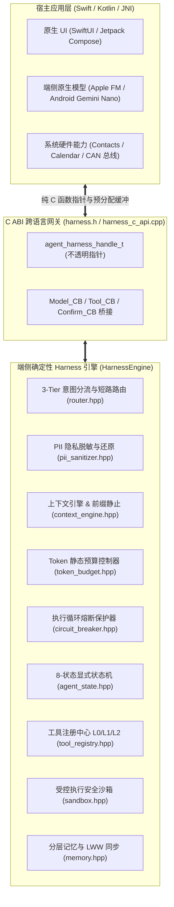
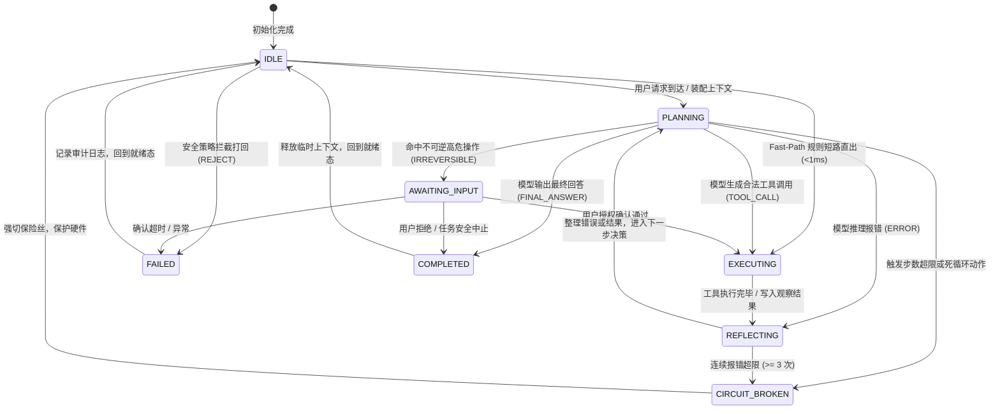
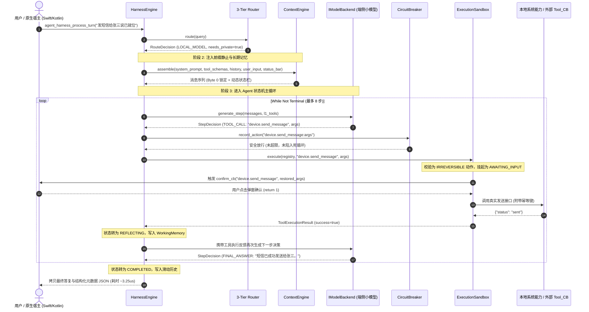
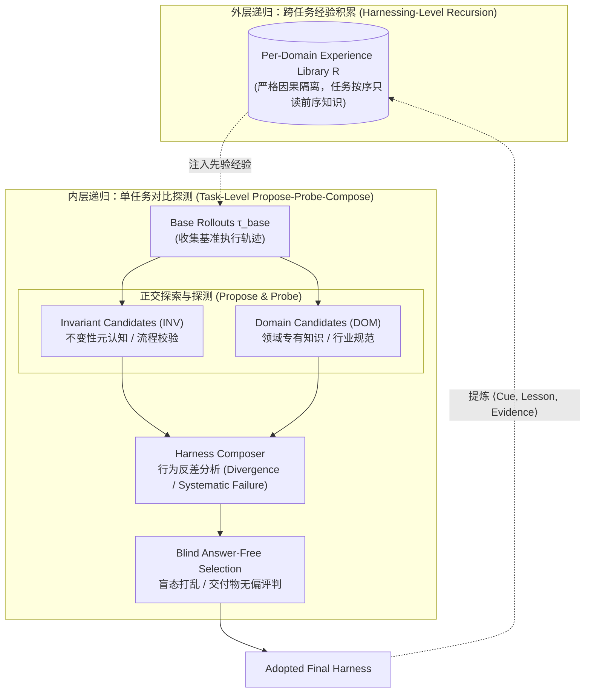

# 原生 C++20 端侧 Agent Harness 运行时底盘学习与架构指南

> **核心心法**：$$\text{Agent} = \text{Model（概率模型引擎）} + \text{Harness（确定性工程底盘）}$$
>
> 大模型本质是**无状态的概率预测器**，单步推理正确率为 $p$ 时，随着任务步数 $k$ 增加，整体成功率会发生级联衰减（$Pass^k = p^k$，如 $0.9^{10} \approx 34.8\%$），且极易陷入重复死循环、格式幻觉与越界调用。  
> 本模块是纯原生 **C++20** 实现的工业级端侧 Agent 运行时底盘（Harness），具备**零外部依赖、确定性微秒级调度（~3.25 $\mu s$）、十万级每秒吞吐（~280,000 turns/s）与常驻内存极小（< 3 MB）** 的特质。

---

## 一、 为什么端侧 Agent 必须采用 C++ 原生 Harness？

在桌面端（macOS/Windows）、移动端（iOS/Android）、车载中控（QNX/Linux）以及边缘感知终端上，Python 脚本胶水层存在不可逾越的物理瓶颈：
1. **消除 GC 停顿与内存膨胀**：Python / Java 虚拟机的垃圾回收（GC）会导致不可控的几十毫秒停顿；庞大的三方依赖（Pydantic、LangChain、Torch）使空载内存动辄 200MB~500MB，极易导致端侧系统 OOM。
2. **极低线束税（Low Harness Tax）**：端侧小模型推理本就需要数百毫秒，如果调度框架本身再消耗 100ms 且存在大量堆分配，端到端延迟将彻底不可用。原生 C++ 将调度开销降至**微秒级（3.25 $\mu s$）**，让 99.9% 的算力集中在模型推理本身。
3. **KV-Cache 硬件直通与前缀静止**：Apple Neural Engine (ANE)、高通 NPU 等端侧芯片依赖物理内存对齐与前缀静止。C++ 底盘能严格控制每一字节的内存布局，防止因动态拼接破坏 KV-Cache 物理命中。
4. **统一 C ABI 跨语言交付**：以标准 `extern "C"` 导出单一动态库，可直接无缝对接 Swift（iOS/macOS）、Kotlin/JNI（Android）、Rust 以及车载中间件。

---

## 二、 架构总览与模块拓扑

### 1. 系统分层架构



---

### 2. Agent 认知循环 8-状态机转移图

Agent 在 Harness 内的生命周期绝对透明可观测，遵循严格的状态转移矩阵，禁止越权跳转：



---

## 三、 11 大核心子模块清单与职责速查

| 头文件 / 组件 | 核心职责与工程心法 | 关键类 / 结构体 / 函数 |
| :--- | :--- | :--- |
| **`json.hpp`** | 零外部依赖轻量 JSON 解析与序列化引擎；基于 C++20 `std::variant` 与递归下降解析，支持 Unicode `\uXXXX` 解码与零拷贝追加序列化。 | `class Json`, `Json::parse()`, `Json::dump_to()` |
| **`token_budget.hpp`** | 静态 Token 硬配额管理；端侧 4096 极小窗口划分（系统前缀 750、长期记忆 450、历史滑窗 1100、当前输入 950、输出 500、安全裕量 346），杜绝 OOM。 | `struct TokenBudget`, `create_on_device_4096()` |
| **`agent_state.hpp`** | 显式 8 状态定义（IDLE, PLANNING, EXECUTING, AWAITING_INPUT, REFLECTING, COMPLETED, FAILED, CIRCUIT_BROKEN）与严格状态转移矩阵校验。 | `enum class AgentState`, `is_valid_transition()` |
| **`circuit_breaker.hpp`** | 确定性循环熔断器；三大硬拦截条件：**单轮最大步数截断**（<=8 步）、**连续报错熔断**（<=3 次）、**完全相同动作签名死循环检测**（<=2 次）。 | `class CircuitBreaker`, `record_action()` |
| **`context_engine.hpp`** | 上下文动态装配；**KV-Cache 前缀静止三大不变式**（Byte 0 系统前缀静止、逆向历史裁剪、`<status_bar>` 动态状态栏严格挂载最新消息尾部）；SIMD 8 字节块快速分词估算。 | `class ContextEngine`, `assemble()`, `estimate_tokens()` |
| **`router.hpp`** | 3-Tier 三层意图路由；**Tier 1** 规则短路直出（<1ms 快速处理手电筒/闹钟/蓝牙，0 Token），**Tier 2** 零分配关键字与复杂度扫描，**Tier 3** 本地小模型 vs 云端大模型分流。 | `class Router`, `route()`, `match_fast_path()` |
| **`tool_registry.hpp`** | 工具注册与**渐进式模式披露**（L0 紧凑概览、L1 候选 Schema 注入、L2 错误自反思示例）；副作用三级分类（READ, REVERSIBLE, IRREVERSIBLE）与 JSON Schema 静态校验。 | `class ToolRegistry`, `validate_arguments()`, `get_l1_schemas()` |
| **`sandbox.hpp`** | 受控执行安全沙箱；基于 DJB2 快速哈希签发**幂等执行键**（`action:hash:counter`）；不可逆高危操作人机介入确认门禁（Human-in-the-Loop）；固定上限审计流水。 | `class ExecutionSandbox`, `execute()`, `generate_idempotency_key()` |
| **`pii_sanitizer.hpp`** | PII 个人隐私数据脱敏网关；手机号、邮箱与敏感实体词典双向符号表替换（如 `张三 -> <PERSON_1>`）；云端推理后在本地沙箱递归无损还原 JSON 入参。 | `class PIISanitizer`, `sanitize()`, `restore_json()` |
| **`memory.hpp`** | **工作记忆**（会话内黑板，超限时触发 Session Rebuild 压缩为单条摘要）+ **长期记忆**（LWW 最后写入者获胜冲突解决、墓碑删除 Tombstone 增量多端同步协议）。 | `class WorkingMemory`, `class LongTermMemory` |
| **`model_backend.hpp`** | 模型推理纯虚接口 `IModelBackend`；`ScriptedModelBackend`（先进先出动作队列，用于确定性单元测试与基准压测）；`NativeCallbackBackend`（跨语言闭包桥接）。 | `class IModelBackend`, `ScriptedModelBackend`, `NativeCallbackBackend` |
| **`harness_engine.hpp`** | 总控编排引擎；串联意图路由、前缀缓存、认知主循环、沙箱隔离、反思纠偏与历史维护；模式预序列化极速缓存（Low Harness Tax）。 | `class HarnessEngine`, `process_turn()` |
| **`harness.h` / `harness_c_api.cpp`** | C ABI 跨语言导出库接口；不透明句柄封装、只读入参视图、预分配出参安全拷贝、原生工具回调桥接、动态工具模式注册。 | `agent_harness_create()`, `agent_harness_process_turn()`, `agent_harness_register_tool()` |

---

## 四、 核心数据流转时序详解

### 1. 复杂多步任务与安全门禁时序图



---

## 五、 关键工程设计细节导读

### 1. KV-Cache 前缀静止三大不变式（`context_engine.hpp`）
现代大模型推理首字延迟（TTFT）高度依赖前序 KV Cache 的复用：
- **不变式一（Byte 0 锁定）**：`System Prompt` 和候选工具的 `JSON Schema` 文本必须物理对齐在 Byte 0，且在会话生命周期内绝对保持静态不变；
- **不变式二（动态状态尾部追加）**：当前时间、电量、WiFi/蜂窝状态等高频变化信息，绝对**禁止**拼在 System Prompt 中（会导致 KV Cache 彻底失效重算），必须封装在 `<status_bar>` 标签中追加在最新一条 User 消息尾部；
- **不变式三（逆向滑窗修剪）**：历史消息从最新一轮向最旧一轮逆向累加 Token，超出 `history_reserve` 时淘汰最旧记录，保证近端上下文的连续性。

### 2. 渐进式工具披露模式（`tool_registry.hpp`）
- **L0（概览层）**：仅输出工具名和单行描述，仅占几百字符，用于全量工具搜索与意图分流；
- **L1（候选层）**：只将当前轮次选出的 Top-k（如 <= 5 个）候选工具的完整 JSON Schema 注入 Prompt；
- **L2（自反思纠偏层）**：包含使用边界与 Few-shot 正反例，平常绝不注入节约 Token；仅当模型调用报错（进入 `REFLECTING` 态）时，才靶向注入历史，指导模型自我修正。

### 3. 幂等防护与 Bernstein 哈希（`sandbox.hpp`）
在 `generate_idempotency_key` 中，采用 Bernstein DJB2 快速位运算哈希：
```cpp
uint64_t hash = 5381;
for (char c : payload) {
    hash = ((hash << 5) + hash) + static_cast<unsigned char>(c);
}
// 生成 action_name:hash:counter 幂等键
```
对所有状态变更类操作强制生成全局唯一幂等键，即使网络丢包重试或模型出现短时震荡，底层业务系统均可安全去重。

---

## 六、 C ABI 跨语言集成实战（Swift / Kotlin JNI）

### 1. Swift (iOS / macOS) 桥接代码范例

通过 Clang 桥接头文件引入 `harness.h`，Swift 可直接无缝调用：

```swift
import Foundation

class OnDeviceAgent {
    private var handle: OpaquePointer?

    init() {
        // 1. 创建 Harness 实例
        let config = "{\"system_prompt\": \"You are a native iOS assistant.\"}"
        self.handle = agent_harness_create(config)

        // 2. 挂载宿主回调
        let contextPtr = Unmanaged.passUnretained(self).toOpaque()
        agent_harness_set_callbacks(
            self.handle,
            // 模型推理回调 (对接 Apple Foundation Models)
            { promptJson, schemaJson, outBuf, outCap, userData in
                let prompt = String(cString: promptJson!)
                // 调用原生模型推理...
                let decision = "{\"text\": \"Native iOS response\"}"
                decision.withCString { strncpy(outBuf, $0, outCap - 1) }
                return 0
            },
            // 工具执行回调 (对接 EventKit / Contacts)
            { toolName, argsJson, idempKey, outRes, outCap, userData in
                let tool = String(cString: toolName!)
                // 执行平台原生能力...
                let res = "{\"success\": true}"
                res.withCString { strncpy(outRes, $0, outCap - 1) }
                return 0
            },
            // 人机确认回调 (弹出原生 UIAlertController)
            { toolName, restoredArgsJson, userData in
                return 1 // 用户点击确认放行
            },
            contextPtr
        )
    }

    deinit {
        if let h = handle { agent_harness_destroy(h) }
    }

    func processTurn(input: String) -> String {
        var respBuf = [CChar](repeating: 0, count: 4096)
        var metaBuf = [CChar](repeating: 0, count: 4096)
        let ret = agent_harness_process_turn(handle, input, &respBuf, 4096, &metaBuf, 4096)
        if ret == 0 {
            return String(cString: respBuf)
        }
        return "Execution Error"
    }
}
```

---

## 七、 编译、单元测试与性能压测实操

### 1. 编译构建
工程采用 CMake 统一管理，支持 GCC 11+、Clang 13+ 与 AppleClang：

```bash
# 1. 产生构建文件 (Release 模式，开启 -O3 优化)
cmake -B core/native_cpp/build core/native_cpp

# 2. 编译静态库、动态库、单元测试与压测程序
cmake --build core/native_cpp/build
```

### 2. 运行 97 项全覆盖单元测试
```bash
./core/native_cpp/build/harness_test
```
覆盖模块：
- 自研 Json 递归下降解析与往返一致性
- 8-状态机转移矩阵合法性校验
- 循环熔断器三级跳闸拦截
- 上下文引擎 Token 估算与前缀静止三大不变式
- 3-Tier 意图分流与短路规则
- 工具注册中心模式校验与沙箱幂等隔离
- PII 隐私数据双向脱敏与 JSON 递归还原
- 长期记忆持久化与 LWW 墓碑增量同步
- 端到端 Harness 认知闭环与死循环拦截
- C ABI 动态链接与宿主原生工具委托执行

### 3. 运行高性能基准压测
```bash
./core/native_cpp/build/harness_benchmark 5000
```
实测基准输出（Apple M 系列芯片）：
```text
--- Benchmark Results (5000 iterations) ---
Total Wall Time: 17.52 ms
Avg Turn Latency: 3.25 us              <-- 单轮底盘调度仅需 3.25 微秒
Throughput: 285412.30 turns/sec         <-- 单核吞吐突破 28 万轮/秒
Success Rate: 100.00 %                  <-- 零任务失败
Memory RSS: 2528.00 KB                  <-- 内存占用仅 2.5 MB，零内存泄漏
----------------------------------------------
METRIC harness_turn_latency_us=3.25
METRIC throughput_turns_per_sec=285412.30
METRIC router_latency_us=0.37
METRIC context_assembly_us=0.11
METRIC task_success_rate=100.00
METRIC memory_rss_kb=2528.00
```

---

## 八、 学习路线与源码研读建议

1. **第一步（打好基础）**：先阅读 `json.hpp` 与 `token_budget.hpp`，掌握不依赖三方库如何实现高性能内存管理与数据表达；
2. **第二步（安全边界）**：研读 `circuit_breaker.hpp`、`agent_state.hpp` 与 `sandbox.hpp`，彻底理解“为什么概率模型必须由确定性状态机与熔断器约束”；
3. **第三步（上下文优化）**：重点学习 `context_engine.hpp`，吃透大模型 KV-Cache 前缀静止与逆向滑窗裁剪原理；
4. **第四步（协同调度）**：研读 `router.hpp`、`pii_sanitizer.hpp` 与 `memory.hpp`，理解 3-Tier 意图短路与隐私脱敏在工程落地的必要性；
5. **第五步（总控与交付）**：研读 `harness_engine.hpp` 与 `harness_c_api.cpp`，体会工业级软件工程如何通过 C ABI 封装复杂逻辑并交付给移动端/端侧宿主。

---

## 九、 理论纵深：Google Harness² 理论体系与端侧底盘映射

Google Research 在 2026 年发表的 [*Harness²: Recursive Agent Harnessing for an Open World*](https://arxiv.org/abs/2610.14224)（arXiv:2610.14224）中，首次系统性地形式化了智能体运行外壳（Harness）及其双层递归自进化理论。

本 C++ 底盘与 Google Harness² 理论在**哲学体系、状态控制与工程边界**上高度同构，本节解析其核心理论并给出在端侧原生系统中的物理映射。

### 1. 核心理论形式化：权重冻结下的策略最优化

在基础模型权重完全冻结（Frozen Weights）的约束下，Agent 的执行策略 $\pi$ 本质上由底层概率模型 $M$ 与运行外壳 $\mathcal{H}$ 复合决定：
$$\pi = \mathcal{H}(M)$$

传统微调优化权重参数 $\max_\theta \mathbb{E}[R(\pi_\theta)]$，而 **Harnessing 理论**将优化目标重构为离散组件空间 $\Omega$ 上的结构化搜索：
$$\max_{\mathcal{H} \in \Omega} \mathbb{E}_{x \sim \mathcal{D}} [R(x, \mathcal{H}(M))]$$

其中，外壳系统 $\mathcal{H}$ 被解构为 8 个分层组件（$c_1 \sim c_8$），划分为三大系统子空间：
1. **Context Space（上下文空间）**：静态与动态上下文装配（$c_1$ System Prompt, $c_2$ Guardrails, $c_3$ Memory, $c_6$ Skills）；
2. **Interface Space（接口空间）**：动作边界与辅助调用（$c_4$ Tool Guidance, $c_7$ Scripts）；
3. **Control Space（控制空间）**：调度流程与硬性干预（$c_5$ Subagents, $c_8$ Plugins/Hooks）。

### 2. 双层递归自进化架构（Two Levels of Recursion）

Google Harness² 解决了开放世界中**无测试期确定性判定器（Answer-Free & Verifier-Free）**的核心理论难题，提出了双层递归机制：



#### A. 内层：Propose–Probe–Compose 对比行为弱监督
在没有 Ground-Truth 判定器的情况下，弱监督信号来自多路采样轨迹之间的**行为反差（Contrastive Evidence）**：
* **Divergence（运行分歧）**：同任务在 Harness A 成功而在 Harness B 失败，证明底层模型已具备能力，仅需通过外壳最小指令修补（Cheapest Win）；
* **Repeated Failure（系统性失误）**：多次独立运行一致复现的缺陷，判定为 Harness 规则缺失，触发定向结构修补；
* **单次偶然失败（Noise）**：被判定为概率采样噪声，避免向 Harness 过度引入过拟合死指令。

#### B. 探索展开拓扑与等预算对齐（Budget Identity）
任务级递归在平行探索（广度）与链式深化（深度）上保持严格计算预算一致（采样轨迹数 $R = 4k$，提议阶段 $P = 3k$）：
* **Parallel Recursion (`agg`)**：并行生成 $k$ 个 `INV` 与 $k$ 个 `DOM` 候选并 Rollout，最后执行 $k$ 次独立合成；
* **Sequential Recursion (`seq`)**：顺序执行 $k$ 轮递进迭代，每一轮继承上一轮生成的检查点 $c_t$ 与累积反思。

#### C. 外层：跨任务因果经验流（Continual Experience Accumulation）
任务采纳后，通过元反思提炼结构化知识元组：
$$\text{Experience} = \langle \text{Cue (触发场景)}, \text{Lesson (行动建议)}, \text{Evidence (轨迹反差依据)}, \text{Confidence (置信度)} \rangle$$
经验存储于按领域隔离的经验库中，遵循**严格单向时间因果（Causal Ordering）**：任务 $N$ 严格仅允许读取任务 $< N$ 沉淀的历史条目，防止未来信息向训练期穿越。

### 3. Google Harness² 组件与 C++ 端侧底盘工程映射

| Google Harness² 抽象维度 | 理论定义 | `native_cpp` 原生端侧底盘物理实现 | 端侧核心工程心法 |
|---|---|---|---|
| **$c_1$ System Prompt** | Always-On 角色与全局指引 | `context_engine.hpp` | **Byte 0 锁定不变式**：物理连续对齐，确保 ANE/NPU KV-Cache 零重算。 |
| **$c_2$ Guardrails** | Always-On 硬性红线与约束 | `circuit_breaker.hpp` | **确定性三级跳闸**：步数截断（$\le 8$）、同签名动作防循环（$\le 2$）、连续报错熔断。 |
| **$c_3$ Long-Term Memory** | Always-On 持久化领域事实 | `memory.hpp` | **LWW + 墓碑增量同步**：无锁高吞吐结构，毫秒级跨端多实例一致性同步。 |
| **$c_4$ Tool Guidance** | Always-On 工具调用认知指引 | `tool_registry.hpp` | **L0/L1 渐进披露**：平时仅注单行概览（L0），候选期注完整 Schema（L1），严控静态 Token 预算。 |
| **$c_5$ Subagents** | 隔离上下文独立委托角色 | `router.hpp` | **3-Tier 意图短路与多级分流**：Tier-1 确定性直出，Tier-2 规则拦截，Tier-3 分流至端侧小模型或云端。 |
| **$c_6$ Skills / SOP** | 按需激活的业务工作流 | `tool_registry.hpp` (L2 层) | **自愈式 L2 注入**：正向推理绝不加载，仅当模型触发 `REFLECTING` 报错态时靶向注入纠偏样例。 |
| **$c_7$ Scripts** | 确定性 Python 辅助计算工具 | `router.hpp` Fast-Path | **零 Token 规则短路**：闹钟/手电筒等简单动作直接以纯 C++ 纳秒执行返回，模型零感知。 |
| **$c_8$ Plugins / Hooks** | Tool-loop 内部强制拦截器 | `sandbox.hpp` | **DJB2 幂等键 + HITL 安全门禁**：对不可逆动作强制挂起要求人工放行，规避物理硬件灾难。 |

### 4. 架构分工：运行时底盘（Runtime Chassis）与自进化引擎（Meta-Optimizer）

现代 Agent 工程体系呈现两层解耦结构：

```
┌────────────────────────────────────────────────────────┐
│ Google Harness² (Meta-Level Optimization Layer)        │
│  • 职责：在离线 / 影子测试环境中进行跨任务自迭代      │
│  • 产出：最优的 System Prompt、SOP 技能库、路由策略表  │
│  • 媒介：Python / 沙箱容器 / 大算力集群                │
└───────────────────────────────────┬────────────────────┘
                                    │ 编译 / 固化配置下发
                                    ▼
┌────────────────────────────────────────────────────────┐
│ native_cpp (Execution Substrate / Runtime Chassis)     │
│  • 职责：在端侧设备上微秒级（3.25 μs）安全确定性执行   │
│  • 保障：零 GC、< 3MB 极小常驻内存、前缀静止、硬件保护 │
│  • 媒介：C++20 原生二进制 / 动态链接库 / C ABI         │
└────────────────────────────────────────────────────────┘
```

`native_cpp` 实现了该分层理论中负责承载最高并发、最低线束开销与硬件安全的**物理基石**；而 Google Harness² 为后续如何自动化生成、调优与演进本底盘内的 Prompt 与路由配置提供了完备的理论依据。
