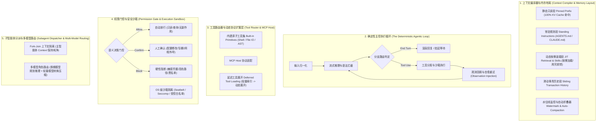

# 01 通用 Agent Harness 架构设计规范

## 1. 设计定位与第一性原理

在现代 AI 工程体系中，大语言模型（LLM）本身仅是一个无状态的概率序列推理器（Stateless Token Predictor），它不具备持久记忆、不感知外部物理时间、也无法直接操作操作系统资源。**Agent Harness（智能体运行时底座/挽具）** 则是包裹在模型外层的有状态操作系统内核（OS Kernel for LLMs）。

以 OpenCode、Claude Code Harness、OpenHarness 以及 ECC (Agent Harness Performance Optimization System) 为代表的通用 Agent Harness，其核心工程使命是用确定性的系统工程护栏去驾驭、收敛并放大非确定性的模型推理能力：

* **状态外置与持久化**：将模型每一次无状态的推理请求，桥接至持久化的文件系统、上下文缓存与记忆数据库。
* **感知与动作闭环**：将外部世界的状态变化编码为结构化 Observation 注入模型上下文，并将模型的符号化输出解析为受控的系统调用（System Calls / Tool Calls）。
* **边界约束与故障自愈**：在模型产生幻觉、越权操作或工具调用失败时，提供权限拦截、超时熔断与错误回填自愈机制。

```
+-----------------------------------------------------------------------+
|                        大语言模型 (LLM / SLM)                          |
|             职责：概率推理、理解与规划（无状态 Token 预测器）            |
+-----------------------------------+-----------------------------------+
                                    | 符号输出 / Tool Call 意图
+-----------------------------------v-----------------------------------+
|                   通用 Agent Harness (智能体运行时内核)                 |
|  [上下文编译器与内存段]    [确定性主控循环]       [工具路由与 MCP 宿主]   |
|  [权限门控与安全沙箱]      [水位线与自动压缩]     [子智能体隔离分派]      |
+-----------------------------------+-----------------------------------+
                                    | 确定性系统调用 / 安全沙箱执行
+-----------------------------------v-----------------------------------+
|               操作系统、物理世界与外部服务 (OS / Files / APIs)            |
+-----------------------------------------------------------------------+
```

---

## 2. 通用 Agent Harness 的五层标准架构

一个生产级通用 Agent Harness 通常采用离散轮次驱动的同步/半双工架构（Turn-based Synchronous/Half-Duplex Loop），由自顶向下的五个标准子系统构成：



### 2.1 上下文编译器与内存布局管理层（Context Compiler & Memory Layout）
上下文窗口（Context Window）本质上是 Agent 的“主存（RAM）”。通用 Harness 绝不是简单地拼接历史聊天记录，而是像编译器管理内存段一样严格划分上下文布局：

* **静态只读段（Pinned Prefix Segment）**：存放系统级角色指令（System Prompt）、全局行为准则以及高频核心工具的 Schema 定义。Harness 必须保证该段落在整个会话生命周期内字节级恒定，从而 100% 命中推理引擎的 Prompt KV Cache（前缀缓存），将每轮推理的首字延迟（TTFT）与算力成本降低一个数量级。
* **持久项目与身份规则段（Standing Instructions & Persona）**：自动挂载工作区或用户级常驻配置文件（如 OpenCode 架构中的 `AGENTS.md` 或 Claude 体系中的 `CLAUDE.md`），确保跨会话的一致性。
* **动态按需装载段（Just-in-Time Retrieval & Skills）**：通过语义检索（RAG）或按需技能加载器（Skill Loader）在当前轮次动态注入的知识片段，用完即焚或按热度淘汰，避免无关长文档永久污染主窗口。
* **滑动事务历史段（Sliding Transaction History）**：记录近期用户指令、模型思考链、工具调用参数与工具返回结果。
* **水位线监控与自动折叠器（Watermark & Auto-Compaction）**：当上下文 Token 占用率突破预设水位线（如最大窗口的 75%~80%）时，Harness 自动挂起主循环，调用后台压缩流将早期的多轮工具调用细节与冗余探索过程蒸馏为高密度的结构化状态快照（State Handoff Summary），释放主窗口空间。

### 2.2 确定性主控执行循环（The Deterministic Agentic Loop）
通用 Harness 的心脏是一个受状态机严格管控的 ReAct（Reasoning + Acting）事件循环：

1. **输入归一化**：接收用户的离散输入，组装当前轮次的增量上下文。
2. **流式推理与语法拦截**：驱动底层模型流式生成 Token，实时检测输出流中是否包含结构化的工具调用标记或终止符。
3. **分支路由判定**：
   * 若终止原因为自然结束（`End Turn`），则将最终回复渲染至用户界面，主循环进入挂起态等待下一轮输入。
   * 若终止原因为请求调用工具（`Tool Use`），主循环保持激活，进入工具分发与沙箱执行阶段。
4. **观测回填与自愈重试（Observation Injection & Self-Correction）**：将工具执行的标准输出、错误堆栈或超时信息封装为结构化消息追加至上下文尾部，自动触发下一轮模型推理，使模型能够根据报错信息自主修正参数重试，直至任务闭环或触发最大步数熔断阈值。

### 2.3 工具路由器与动态协议扩展层（Tool Router & MCP Host）
为了兼顾能力广度与上下文精简，通用 Harness 将工具体系划分为两层：

* **内建原子工具集（Built-in Primitives）**：由宿主语言原生实现的极速工具，如受控 Shell 执行、精确文件读写、AST/正则搜索等。
* **标准化外部协议扩展（MCP Host & Deferred Tool Loading）**：通过 Model Context Protocol (MCP) 接入外部数据源与服务。当注册工具数量达到数十上百个时，Harness 采用**延迟工具展开（Deferred Tool Expansion）**策略——初始仅在上下文中暴露轻量的工具目录索引，待模型明确声明需要某项能力时，再动态注入该工具的完整参数 Schema。

### 2.4 权限门控与安全沙箱（Permission Gate & Execution Sandbox）
任何具备外部副作用（Side Effects）的动作在进入操作系统执行前，必须经过 Harness 的两道安全防线：

* **语义决策门控（Semantic Decision Gate）**：根据工具的读写属性与目标路径进行三态分类：
  * **Allow（自动放行）**：工作区内的只读文件查看、状态查询、无副作用计算。
  * **Confirm（人工确认）**：修改系统配置、执行含网络或删除语义的命令、向外部发送消息。Harness 会冻结当前执行协程，向用户弹出确认卡片，获批后方可执行，拒绝则将拒绝原因作为 Observation 回传模型。
  * **Block（硬性阻断）**：访问敏感凭据目录、破坏性系统指令或命中黑名单策略的操作，直接由策略引擎拦截报错。
* **操作系统级沙箱隔离**：通过操作系统的权限机制（如 macOS Seatbelt、Linux Namespace/Seccomp 或受控目录白名单）限制子进程的文件系统可见范围与网络访问边界。

### 2.5 子智能体分派与多模型路由（Subagent Dispatcher & Multi-Model Routing）
面对大型复杂任务，单一主循环会出现“上下文爆炸”与“注意力稀释”：

* **Fork-Join 上下文隔离**：参考 OpenRig 与 OpenHarness 的多智能体协同模式，主智能体（Planner）可以将高噪声的局部探索任务（如阅读数十篇文档或遍历大型代码库）派发给拥有独立全新上下文窗口的 Subagent（子智能体） 并发执行。子智能体销毁前仅向主循环返回数十字至数百字的精炼结论，保持主智能体上下文绝对干净。
* **多模型角色路由（Multi-Model Role Routing）**：Harness 根据当前步骤的计算特征动态切换后端模型——架构规划与复杂推理路由至高智商旗舰大模型；高频格式转换、上下文摘要压缩与简单路由分类则分流至低延迟、低成本的轻量模型。

---

## 3. 主流通用 Agent Harness 顶级开源项目精选与架构剖析

构建纯正的通用 Agent Harness（区分于上层应用级助手或重型工作流胶水框架），需要重点攻坚**状态机流转、沙箱隔离、协议抽象、内存段对齐与进程级权限控制**。业界有五个最具有底盘参考价值的纯正开源项目：

### 3.1 核心开源项目选型全景矩阵

| 项目名称 | 源码地址 / 机构 | 核心定位与架构范式 | 最值得学习的核心机制（Harness 纯底座） |
| :--- | :--- | :--- | :--- |
| **OpenHarness** | `OpenHarness/OpenHarness` | **跨模型、跨 Agent 的统一评估与执行运行时底座** | 标准化 Agent 生命周期状态机、统一工具沙箱接口（Sandbox Abstraction）、隔离式执行驱动器 |
| **AgentBench** | `THUDM/AgentBench` | **工业级通用 Agent 交互基准与通用环境运行时** | 多环境抽象（OS / DB / Web / API）、结构化 Observation 回填机制、确定性多轮交互驱动循环 |
| **SWE-bench (SWE-harness)** | `princeton-nlp/SWE-bench` | **通用软件工程与任务型 Agent 的沙箱执行 Harness** | 生产级 Docker/Firecracker 沙箱生命周期隔离、副作用拦截、执行日志/错误捕获与状态重置 |
| **lm-evaluation-harness** | `EleutherAI/lm-evaluation-harness` | **模型/推理 Harness 的工业标准鼻祖** | 严格的 Prompt 模版编译器、Token 边界与缓存锁定、零泄漏输入输出上下文处理机制 |
| **OpenCode Runtime** | `anomalyco/opencode` | **通用交互式 Agent 运行时底座（Runtime Daemon）** | 本地守护进程架构、三态权限门控（Allow/Confirm/Block）、MCP 协议原生 Host 宿主实现 |

### 3.2 深度解构：学什么、看哪个模块？

#### 1. OpenHarness (`OpenHarness/OpenHarness`) —— 跨厂商统一生命周期接口
* **核心价值**：专门解决“如何以统一的运行时底盘去承接和驱动不同模型及 Agent 内核”。
* **关键架构模块**：
  * **统一生命周期接口（Unified Lifecycle Interface）**：将 Agent 运行切片为标准化的五个生命周期阶段：初始化（`Init`）$\rightarrow$ 轮次驱动（`Step`）$\rightarrow$ 异步挂起（`Suspend`）$\rightarrow$ 外部反馈恢复（`Resume`）$\rightarrow$ 销毁与资源清理（`Teardown`）。
  * **沙箱抽象层（Sandbox Abstraction Layer）**：定义无视宿主物理差异的执行环境抽象接口，支持在本地子进程、Docker 容器或远端隔离沙箱间无感切换。

#### 2. AgentBench (`THUDM/AgentBench`) —— 确定性多轮交互驱动引擎
* **核心价值**：清华 KEG 出品的通用 Agent 交互式底座，具备高可靠的离散交互循环实现。
* **关键架构模块**：
  * **轮次交互引擎（Turn-based Engine）**：设计了防死锁、防超时、带熔断机制的离散执行主控循环。
  * **Observation 注入与归一化（Observation Normalization）**：将异构环境返回的非结构化数据（Shell 返回码、标准错误流、数据库异常、网络超时）统一清洗为结构化消息包注入模型上下文，防止脏数据击垮注意力。

#### 3. SWE-bench Harness (`princeton-nlp/SWE-bench`) —— 任务级沙箱与环境重置
* **核心价值**：工业界处理**长轨迹、带外部副作用操作**最为硬核的执行 Harness 参考实现。
* **关键架构模块**（位于源码 `swebench/harness/`）：
  * **沙箱生命周期与状态快照（Environment Provisioning）**：基于容器与文件系统快照技术，确保每次复杂破坏性操作前后可在秒级实现环境复原与数据隔离。
  * **底层资源限制与超时强杀（Timeout & Resource Limiter）**：在系统调用层注入 `ulimit` 与 `SIGKILL` 级超时看门狗，杜绝模型伪造死循环脚本拖垮 Harness 宿主进程。

#### 4. EleutherAI lm-evaluation-harness (`EleutherAI/lm-evaluation-harness`) —— 字节级对齐与缓存锁定
* **核心价值**：现代 LLM 生态中“Harness”概念的源头工程标准。
* **关键架构模块**：
  * **上下文编译与 Token 对齐（Context Layout & Alignment）**：严格控制输入字符串的空白符、特殊定界符与分词边界，确保静态 Prompt 前缀 100% 对齐并命中推理后端的 KV Cache。
  * **流式拦截与早停控制（Streaming Interceptors & Early Stopping）**：在流式生成阶段高效检测终止符（Stop Sequence）与格式断言，避免多余 Token 浪费。

#### 5. OpenCode Runtime Daemon (`anomalyco/opencode`) —— 生产级交互守护进程与权限门控
* **核心价值**：适合构建需要长期驻留操作系统、与 IDE / 终端 / Web 前端通信的现代 Agent 引擎。
* **关键架构模块**（位于 `packages/core` 与 `packages/agent`）：
  * **客户端-守护进程分离（Daemon Architecture）**：Harness 核心作为常驻后台服务运行，通过 JSON-RPC/SSE 与上层交互，支持跨会话状态恢复与 SQLite 持久化。
  * **三态权限门控状态机（Permission State Machine）**：严密管控每一个外部动作，只读操作自动放行，破坏性动作（文件改写、网络外发、命令执行）自动冻结当前协程并向外弹出审批事件，获批后唤醒继续执行。
  * **原生 MCP 宿主（Model Context Protocol Host）**：开箱即用支持工业级标准工具生态的发现、加载与延迟展开。
