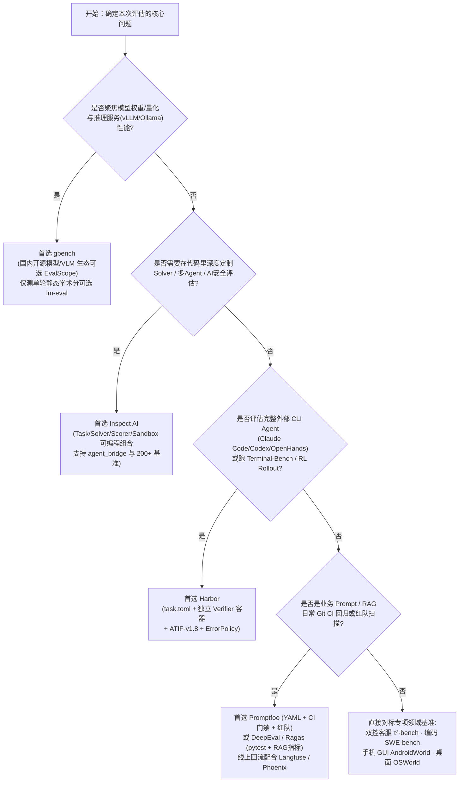

# AI Agent 评估框架选型对比与工程架构指南

> **文档定位**：针对“模型/推理服务准入、自研 Harness 沙盒开发、外部 CLI Agent 端到端基准、业务应用 CI 回归”四类截然不同的评估诉求，系统对比 **`gbench`**、**`Inspect AI`**、**`Harbor`** 与主流生态工具（`EvalScope`、`lm-eval`、`Promptfoo`、`DeepEval`、`Ragas` 等），给出可落地的选型决策流、深层工程机制对照与本仓库落地点索引。  
> **核心公式**：$$\text{Agent} = \text{Model（概率模型引擎）} + \text{Harness（确定性工程底座）}$$

---

## 一、 四大评估阵营全景对比

AI Agent 评估工具并非相互替代的平替品，而是各自锚定不同的**被测对象（Subject）**与**工程层级**：

| 阵营 | 代表项目 | 核心被测对象 | Serving 性能联测 | 沙盒与多轮交互 | 典型强项 | 典型盲区 |
| :--- | :--- | :--- | :---: | :---: | :--- | :--- |
| **1. 模型与推理服务联合基准** | **`gbench`**、`EvalScope`、`lm-eval`、`LightEval`、`OpenCompass` | 模型权重、量化精度、`/v1` 推理端点 | **`gbench` / `EvalScope` 原生支持** | `gbench` 含 Relay 与容器 QA；其余偏单轮或脚本 | 统一量化/并发/TTFT/TPOT/ITL 与学术能力底线；`gbench` 含模板成对隔离 | 不负责在内部编排复杂的自定义多 Agent 代码逻辑 |
| **2. 可编程沙盒与安全评估底座** | **`Inspect AI`** (`UKGovernmentBEIS/inspect_ai`) | 可编程 `Task(dataset, solver, scorer, sandbox)` | 不测硬件吞吐 / 尾延迟 | **极强**（Docker / K8s / Daytona / Modal / OpenShell 等） | `react` / `handoff` / `agent_bridge` 可编程组合、200+ 基准、AI 安全/红队、预期与非预期错误隔离 | 不锁定 vLLM 量化与Serving 负载曲线 |
| **3. 容器化外部 Agent 调度器** | **`Harbor`** (`laude-institute/harbor`) | 完整 Agent 产品 / CLI（Claude Code、Codex、OpenHands 等） | 不测硬件 ITL | **极强**（每题独立容器、独立 Verifier 沙盒、多步骤任务） | **Terminal-Bench 2.0 官方底座**、`task.toml` 自包含任务包、`ErrorPolicy`、`ATIF-v1.8` 轨迹标准与 RL Rollout | 偏重容器化端到端任务，不直接做 Chat Template Token 级成对诊断 |
| **4. 应用 CI 门禁与 RAG 评估** | **`Promptfoo`**、**`DeepEval`**、**`Ragas`** + `Langfuse` / `Phoenix` | 业务 Prompt、RAG 检索管道、在线工作流 | 仅基础耗时 | 偏对话模拟与检索上下文断言 | YAML / `pytest` 极易进 GitHub Actions CI、红队越狱扫描、线上 Trace 回流 | 缺少操作系统/Git/终端级别的隔离容器编排 |

---

## 二、 核心三剑客深度对比：`gbench` × `Inspect AI` × `Harbor`

本仓库 [`evals/`](../../evals/README.md) 与 [`experiments/chapter7/`](../../experiments/chapter7/README.md) 重点整合了上述生态中最具工程代表性的三个开源底座：**`gbench`**（7-15）、**`Inspect AI`**（7-16）与 **`Harbor`**（7-17）。三者的底层设计哲学差异如下：

### 1. 工程能力矩阵对照

| 对比维度 | `google-deepmind/gbench` (Apache-2.0) | `UKGovernmentBEIS/inspect_ai` (MIT) | `laude-institute/harbor` (Apache-2.0) |
| :--- | :--- | :--- | :--- |
| **设计原点** | “推理部署 + 能力”联合准入，消灭测试尺子漂移 | AI 安全研究所（UK AISI）可复现前沿能力与安全评估 | Terminal-Bench 团队打造的容器化 Agent 评测与 RL 训练调度器 |
| **核心抽象单元** | `SubjectSpec` + `ScaffoldSpec` + 3-Tier Suites + `--campaign` | `Task(dataset, solver, scorer, sandbox)` + `@agent` | `Task Dir` (`instruction.md` + `task.toml` + `environment/` + `tests/test.sh`) → `Trial` |
| **对“被测 Agent”的集成方式** | 通过 `/v1` HTTP 端点或 Progress-based Endpoint Relay 驱动 | 内置 `react()` / `handoff()`；或用 `agent_bridge()` / `sandbox_agent_bridge()` 拦截外部 Agent | 原生预集成 Claude Code、Codex CLI、OpenHands 等，也支持 ACP 与自定义 `BaseAgent` |
| **沙盒隔离机制** | Tier 3 GemmaClaw 跑在 `gbench-quality` 容器；Tier 1 套件自带容器 | 内置 `docker` / `local`，扩展包支持 `k8s` / `daytona` / `modal` / `proxmox` / `vagrant` / `openshell` | 每题独立 `Dockerfile` / `docker-compose.yaml` / `Apptainer.def`；支持 `verifier.environment_mode = "separate"` 防作弊 |
| **基础设施故障 vs 模型失败** | 三态/四态分离 + `infra_required=True` 时 `score=null` | **Expected Errors**（回灌给模型自愈）vs **Unexpected Errors**（不回灌，Sample 记为 `error`） | **`ErrorPolicy(should_retry, should_grade, has_valid_reward)`** 单一真值表；`reward_valid=False` 从均值分子分母同时剔除 |
| **可比性与防作弊机制** | 11 字段双轴哈希（`Subject` / `Scaffold`）+ `covers/unpinned` + `template_*_twin` 成对诊断 | `EvalLog` 全量记录超参/样本/工具事件；`model_aliases` 隔离评测器角色权限 | 内容哈希 + `.harborignore` 隔离本地测试夹具 + 独立 Verifier 容器防止 Agent 篡改 `tests/` |
| **轨迹标准与分析工具** | Run Manifest JSON + `tail_validity` / `block_bootstrap_percentile_ci` | `EvalLog` + Web UI (`inspect view`) + VS Code 插件 | **`ATIF-v1.8` (`trajectory.json`)** + `TrajectoryValidator` + Regrade（免重跑 Agent 重评分） |
| **与 RL / 后训练的衔接** | 偏评估准入，不主打训练数据管线 | 可导出样本与日志供内部分析 | 原生定位“评估 + RL Rollout 优化”双用途（保留 `reward_valid` 合法轨迹） |

### 2. 三者如何处理“环境挂了不算模型零分”？

这是所有严肃 Agent 评估框架最关键的分水岭。三家给出的工程方案高度互补：

1. **`gbench`（端点与模板层隔离）**：  
   - 在 Golden Set 中区分 `passed` / `failed` / `error` / `not_applicable`；  
   - 通过 **Chat Template 成对诊断**（`template_tool_response` vs `template_tool_response_twin`）先排除模板序列化和 Parser Bug；  
   - 依赖 **Progress-based Endpoint Relay** 防止长思考请求触发第三方客户端默认 600s 超时静默断连重采样。
2. **`Inspect AI`（工具契约层隔离）**：  
   - 严格区分 **Expected Error**（如文件不存在、语法错误、命令退出非零——抛出 `ToolError` 回灌给模型看，允许模型自愈）与 **Unexpected Error**（容器网络断连、远端崩溃——直接把样本标记为 `error` 状态，不污染模型能力分）。
3. **`Harbor`（Trial 策略层隔离）**：  
   - 用 `error_policy.py` 把数十种异常精确划分为 5 组三元组 `(should_retry, should_grade, has_valid_reward)`：  
     - `AgentTimeoutError` / `ContextWindowExceededError` → `retry=False, grade=True, reward_valid=True`（模型自己超时/爆窗，合法 `0` 分）；  
     - `EnvironmentStartTimeoutError` / `SandboxBuildFailedError` → `retry=True, grade=False, reward_valid=False`（容器启动失败，重试且不评分）；  
     - `ApiRateLimitError` / `ApiConnectionError` → `retry=True, grade=True, reward_valid=False`（上游限流导致失败，**`reward_valid=False` 既不进分子也不进分母**）。

---

## 三、 选型决策流与场景矩阵

### 按典型研发阶段直接选型

| 研发阶段 / 真实痛点 | 推荐组合 | 关键动作 |
| :--- | :--- | :--- |
| **1. 模型微调/量化后上线前准入** | **`gbench`**（或 `EvalScope`） | 先跑 `--golden-only` 排除 Chat Template 损坏；再跑 `--campaign agentic` 测并发拐点与 `tail_validity`；最后跑 `--evals` 看能力底线。 |
| **2. 自研 Agent Harness 迭代（改循环/记忆/工具）** | **`Inspect AI`** + **`evals.prefix_regression`** | 用 `Task` + `Sandbox` 固定任务与评分器，替换 `Solver` 或用 `agent_bridge()` 接入自研代码；失败轨迹导入 `locate_first_mistake` 定位首错步。 |
| **3. 横向 PK 商业/开源完整 Agent（Claude Code vs Codex vs 自研 CLI）** | **`Harbor`** | 使用 `harbor run -d terminal-bench@2.0 -a <agent> -m <model>` 在统一容器与独立 Verifier 下对比；用 `ATIF-v1.8` 导出轨迹做失败归因与 SFT/RL。 |
| **4. 业务 RAG / 客服工作流发版前 CI 门禁** | **`Promptfoo` / `DeepEval`** + **`τ²-bench`** | 确定性断言 + `Pass^k`（连续 $k$ 次稳定交付，而非偶尔碰巧成功的 `Pass@k`）+ 线上 Trace 沉淀为前缀回归集。 |

---

## 四、 常见选型反模式（Anti-Patterns）

1. **拿 `lm-eval` 单轮分数决定 Agent 上线模型**：静态多选题分数高不代表多轮工具调用不断链，也不代表高并发长上下文下不退化（必须补 `gbench` 或 `Inspect AI` / `Harbor`）。
2. **用 `Promptfoo` 硬写 Docker/OS 级长程沙盒评测**：应用层 CI 工具缺乏独立容器生命周期与 `separate` Verifier 隔离，容易出现环境污染或模型篡改测试文件的 Reward Hacking，应交给 `Inspect AI` 或 `Harbor`。
3. **只看总均分，忽略 `Scaffold` 漂移与无效 Reward**：更换了系统提示词、解码参数或遇到 API 429 限流却仍把 `0` 分算进同一条折线对比；必须严格落实 `Subject` vs `Scaffold` 双轴锁定（`evals/scaffold.py`）与 `reward_valid` 剔除（`evals/frameworks/harbor.py`）。
4. **只查末端报错，不做轨迹首错归因**：第 14 步超时的根因往往在第 3 步工具参数幻觉或第 2 步模板截断；需将 `Inspect EvalLog` 或 `Harbor ATIF` 轨迹导入 `evals/prefix_regression/locator.py` 做二分定位。

---

## 五、 组合落地工作流与本仓库代码映射

推荐工业级团队采用 **“先检服务模板 → 再测可编程沙盒 → 最后跑容器化端到端与首错归因”** 的三段式闭环：

| 环节 | 原型/开源工具 | 本仓库零依赖映射模块 | 第 7 章实战入口 |
| :--- | :--- | :--- | :--- |
| **A. 服务与模板体检** | `google-deepmind/gbench` | [`evals/scaffold.py`](../../evals/scaffold.py)、[`evals/benchmarks/golden_set.py`](../../evals/benchmarks/golden_set.py)、[`evals/metrics/`](../../evals/metrics/reliability.py) | [7-15 `gbench-eval`](../../experiments/chapter7/gbench-eval/README.md)（架构深解见 [`GBENCH_EVALUATION_DEEP_DIVE.md`](GBENCH_EVALUATION_DEEP_DIVE.md)） |
| **B. 可编程沙盒评估** | `UKGovernmentBEIS/inspect_ai` | [`evals/frameworks/inspect_ai.py`](../../evals/frameworks/inspect_ai.py) | [7-16 `inspect-ai-eval`](../../experiments/chapter7/inspect-ai-eval/README.md) |
| **C. 容器化端到端与 ATIF** | `laude-institute/harbor` | [`evals/frameworks/harbor.py`](../../evals/frameworks/harbor.py) | [7-17 `harbor-eval`](../../experiments/chapter7/harbor-eval/README.md)（含标准 `sample_task/`） |
| **D. 轨迹首错回归定位** | 跨框架统一闭环 | [`evals/prefix_regression/locator.py`](../../evals/prefix_regression/locator.py) | 通过 `eval_log_to_trajectory_steps` 与 `atif_to_trajectory_steps` 统一接入 |
| **E. 自动化单元测试守卫** | `unittest`（零外部重依赖） | [`tests/unit/test_evals_gbench.py`](../../tests/unit/test_evals_gbench.py)、[`tests/unit/test_evals_inspect_harbor.py`](../../tests/unit/test_evals_inspect_harbor.py) | `uv run python -m unittest discover -s tests/unit -v` |
