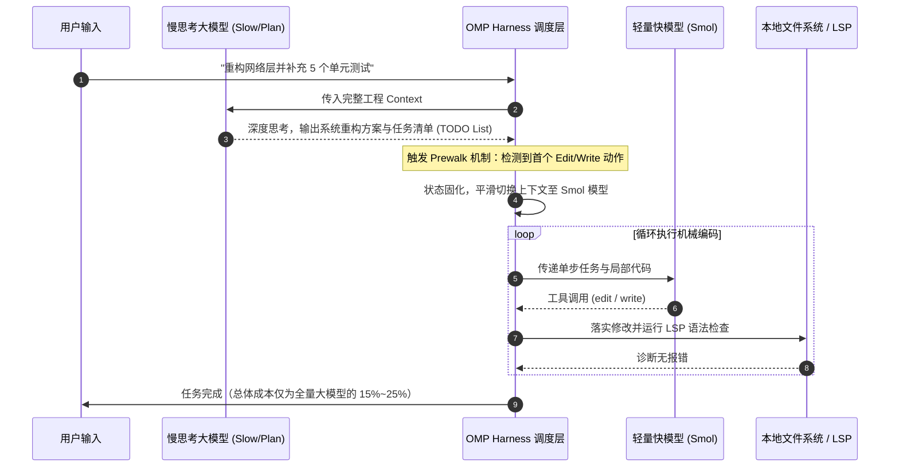
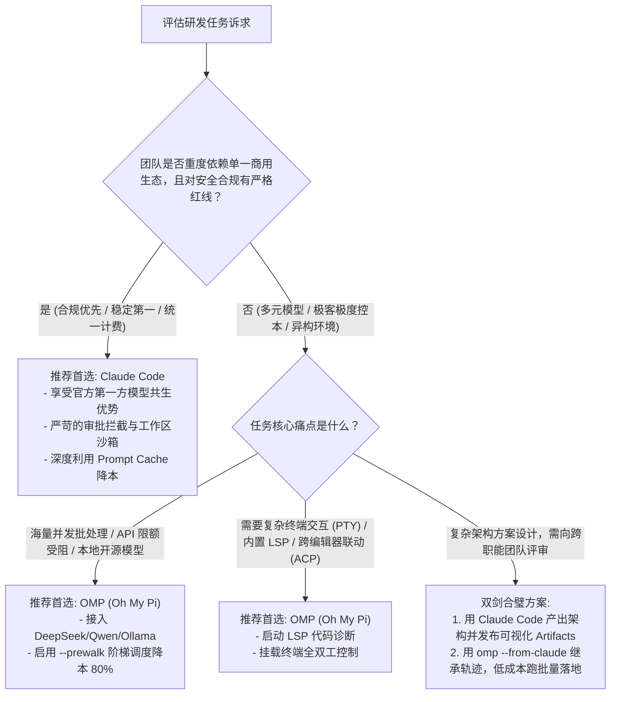

# OMP (Oh My Pi) 与 Claude Code 架构与工程全景对比白皮书

> **文档定位**：站在现代 **AI Agent 系统架构与 Harness 工程底座**视角，对当今两大代表性终端智能体（CLI Agent）—— **Claude Code**（Anthropic 官方垂直一体化标杆）与 **OMP / Oh My Pi**（开源跨厂商异构编排利器）进行全方位、深层次的系统级剖析。  
> **核心公式**：$$\text{Agent} = \text{Model（概率模型引擎）} + \text{Harness（确定性工程底座）}$$  
> **核心法则**：$$\text{Pass}^k = p^k \quad (\text{Compounding Error: 用确定性工程对抗模型不确定性})$$

---

## 一、 执行摘要与两大流派本体论 (Executive Summary & Architectural Archetypes)

在软件工程（Software Engineering）与日常重构、复杂 Debug 的高阶 Agent 任务中，CLI（命令行）已成为最严苛的生产力测试场。终端智能体面临着长轨迹执行、上下文污染、语法/测试闭环、工具副作用以及不可逆磁盘修改等巨大挑战。

当今终端 Agent 技术路线分化出两大截然不同的架构流派：

```
                    ┌────────────────────────────────────────────────────────┐
                    │               现代 CLI Agent 架构两大阵营               │
                    └────────────────────────────────────────────────────────┘
                                   │                          │
                 ┌─────────────────┴─────────┐     ┌──────────┴────────────────┐
                 │       Claude Code         │     │      OMP (Oh My Pi)       │
                 │   【垂直共生体 / 工业标准】  │     │   【通用聚合器 / 极客瑞士军刀】  │
                 └───────────────────────────┘     └───────────────────────────┘
                 • 模型-外围深度协同设计 (Co-Design)   • 30+ 厂商模型中立接入 (Provider-Agnostic)
                 • 极致字节级 Prompt Cache 锁定      • 慢/快模型阶梯分工 (Slow / Smol Prewalk)
                 • 极简保守的安全沙箱与企业护栏       • LSP / PTY / 浏览器 / 桌面原生重装武装
                 • 富交互 Artifacts 与云端协同闭环   • ACP 协议 / Skillshare / Collab 实时直播
```

### 1. 两大流派核心属性横向概览

| 维度指标 | Claude Code (Anthropic 官方) | OMP / Oh My Pi (开源/社区标杆) |
| :--- | :--- | :--- |
| **项目定位** | 官方标杆级生产力代理，垂直深耕企业级可靠性 | 跨厂商极客超级终端，聚焦灵活性与激进成本优化 |
| **核心维护者** | Anthropic 官方团队 | `can1357/oh-my-pi` 开源社区 |
| **底层运行栈** | Node.js / TypeScript (npm 分发) | Bun 编译型原生二进制 (Mach-O / ELF, ~215MB) |
| **模型支持策略** | **第一方优先**：深度绑定 Claude 3.5/3.7/4/5，兼容 Bedrock/Vertex/Foundry | **全面中立聚合**：原生支持 Anthropic, OpenAI, Gemini, Groq, Cerebras, DeepSeek, GLM, Qwen 等 30+ 厂商及本地模型 |
| **模型路由理念** | **单一旗舰贯穿**：主模型（如 Sonnet/Opus）+ 专项子代理（Haiku/Sonnet） | **阶梯异构接力**：`--plan` 规划 $\rightarrow$ `--slow` 深度分析 $\rightarrow$ `--smol` 廉价实施 |
| **缓存优化策略** | **静态前缀字节级锁定**：严格对齐 5-min TTL 缓存窗口，最大化命中 90% 降本 | **多厂商抽象**：以通用 Context Packing 为主，依赖切换小模型从根本上省 Token |
| **代码定位机制** | 原位唯一上下文块替换（Search-and-Replace + `old_string` 校验） | 上下文定位 + **内置 LSP 语言服务协议（语法树/类型诊断）** |
| **扩展协议体系** | MCP (Model Context Protocol) + Workflows 脚本 + Artifacts | MCP + **ACP (Agent Client Protocol)** + Skillshare 技能市场 + 插件系统 |
| **安全沙箱哲学** | **保守防御型**：细粒度权限请求、工作区沙箱隔离、审批模式分级 | **实用激进型**：支持 `yolo` 全自动执行、PTY 交互式终端、原生桌面键鼠劫持 |

---

## 二、 核心心智模型与设计哲学碰撞 (Core Philosophy Clash)

### 哲学一：垂直共生（Co-Design） vs 异构分工（Heterogeneous Staging）

* **Claude Code 的垂直共生论**：
  Anthropic 掌控从基础大模型（Claude 3.5 Sonnet / Claude 3.7 Sonnet Hybrid Thinking）到应用层 API 的全部源码。Claude Code 的 Harness 不需要去揣摩模型的隐藏行为，其 System Prompt 的语法结构、Tool Calling 的 JSON 序列化、思维链（Thinking Block）的分块流式输出与模型底层的预训练偏置完全对齐。这种“模型与外围协同设计”带来了近乎确定性的单步指令遵循率（$p \to 1$）。
* **OMP 的阶梯分工论（Model Staging）**：
  OMP 认为：**用最昂贵的推理模型敲每一行代码是巨大的算力浪费**。它创造性地提出了“双阶段/三阶段阶梯推进”模型：
  * `--plan` / `--slow`：在任务拆解、架构理解与意图推演阶段，调度顶级大模型（如 o3-mini、Opus、Gemini 2.5 Pro）；
  * `--prewalk` / `--plan-yolo`：一旦规划完成生成 TODO 列表，在发起第一个 `edit`/`write` 工具调用时，**自动、静默地将上下文移交给 `--smol` 极廉价模型（如 Haiku、Flash、Qwen-Coder）** 来完成机械的代码替换与脚本运行。



### 哲学二：缓存防卫（Cache Defense） vs 通用解耦（Provider Agnostic）

* **Claude Code 的 Cache-First 原则**：
  遵循 `AGENT.md` 准则第一条——**前缀字节绝对静止**。Prompt 结构被死死钉死在内存中：
  $$\text{Static Prefix} = [\text{System Prompt}] + [\text{Tool Schemas}] + [\text{Project Rules (CLAUDE.md/AGENT.md)}]$$
  严禁在头部注入易变的时间戳或动态计步器。这样在 Anthropic API 机制下，后续连续多轮对话可 100% 命中底层 KV Cache，使得多轮调用的延迟大幅降低，且 Input Token 成本直接折让 90%。
* **OMP 的多厂商中立网关**：
  OMP 需要适配 OpenAI、Google、Groq、Mistral、DeepSeek 及本地 Ollama/vLLM。各大厂商的 Cache 触发机制（如 OpenAI 隐式 1024 Token 自动缓存 vs Anthropic 显式缓存断点 vs Gemini 上下文缓存）大相径庭。OMP 无法为单一厂商做极端的字节级前缀微操，而是将精力投入在**统一协议层、灵活的上下文压缩（`omp compress`）与跨模型断点续传（Session Checkpoint）**。

### 哲学三：极简原子工具 (Conservative Minimalist) vs 极客重装武库 (Swiss-Army Arsenal)

* **Claude Code 遵循 Unix 哲学**：
  核心内置工具极少且高度原子化：`Read`, `Edit`, `Write`, `Bash`, `Grep`, `Glob`, `Agent`, `Workflow`。遇到语法检查？调 `Bash(npm test)`；遇到搜索？调 `Grep/Glob`。将复杂逻辑交给模型自身的通用能力和标准的命令行工具。
* **OMP 拥抱专有高阶协议**：
  OMP 直接将 **LSP (Language Server Protocol)** 搬入内置工具链：
  * 模型调用 `lsp` 工具即可在无编译消耗的情况下，秒级拿到符号定义、跨文件引用、类型推导与实时代码诊断（Diagnostics）；
  * 内置 **PTY 伪终端交互**，模型能够交互式应答 `sudo` 密码输入、`npm init` 引导问答；
  * 内置 **Puppeteer 无头浏览器** 和 **Native Desktop Computer** 工具，具备端到端甚至截屏反思的桌面级操控力。

---

## 三、 六大 Harness 核心模块系统级剖析 (Deep-Dive by Harness Modules)

参照工业级 Agent 设计规范，以下从上下文、状态机、代码变更、工具沙箱、记忆治理与多智能体 6 大核心模块对两者进行解剖。

```
                                  Agent Harness 架构六大支柱对比
┌─────────────────────────┬─────────────────────────────────┬─────────────────────────────────┐
│       Harness 模块      │           Claude Code           │          OMP (Oh My Pi)         │
├─────────────────────────┼─────────────────────────────────┼─────────────────────────────────┤
│ 1. 上下文工程 (Context)  │ 字节级前缀对齐 + 延迟工具检索    │ 动态模板 + 跨厂商 Packing + 压缩 │
│ 2. 状态机与循环 (Loop)   │ ScheduleWakeup 动态步频 + 护栏  │ 硬限制 + 步进熔断 + Advisor 审查│
│ 3. 代码修改 (Coding)    │ 精准锚点唯一替换 (No Line Drift) │ 锚点编辑 + LSP 实时语法/类型诊断 │
│ 4. 工具与沙箱 (Sandbox) │ 原子命令 + 严格权限确认 + MCP   │ PTY 全双工 + 原生 LSP + ACP 协议│
│ 5. 记忆治理 (Memory)    │ 结构化 MEMORY.md + 提案审查机制  │ SQLite (WAL) 关系持久化 + 会话导入│
│ 6. 多智能体 (Multi-Agent│ 确定性 Workflow + Phase 并行管道│ Task 子任务分发 + Cleanse 诊断群│
└─────────────────────────┴─────────────────────────────────┴─────────────────────────────────┘
```

### 1. 上下文工程与提示词编排 (Context Engineering)

#### Claude Code 的精细化控制
* **渐进式披露（Progressive Disclosure）与 ToolSearch**：
  面对庞大的 MCP 工具集，Claude Code 并不一次性将上百个工具的 JSON Schema 全部塞入上下文，而是将次要工具声明为 `deferred` 工具，仅在模型产生需求时通过 `ToolSearch(select:...)` 动态拉取 Schema，极大降低静态上下文占用。
* **Auto-Compaction 自动压缩**：
  在上下文逼近模型滑动窗口极限（如预设的 272k Token 阈值）时，自动触发上下文摘要流，提炼历史决策与文件修改事实，剥离长输出的冗余 Bash 日志，保留关键因果链条。

#### OMP 的灵活与高密度
* **Handlebars 动态模板与覆盖系统**：
  支持 `--system-prompt-template`（Handlebars 语法），用户或工程团队可针对特定项目定制高度动态的注入逻辑；
* **内置离线分词器矩阵（`omp toks`）**：
  打包嵌入了 OpenAI (tiktoken)、Claude、Qwen 等多种离线 Tokenizer，无需联网即可精准计算各厂商真实 Token 消耗；
* **语义语义压缩（`omp compress`）**：
  提供专门的文本浓缩命令，将冗长的说明文档一键重写为高密度的“Prompt 寄存器格式”，剔除自然语言客套话。

---

### 2. 状态机、执行循环与反思熔断 (Loop & Circuit Breaker)

在复合错误率模型中：
$$\text{Pass}^k = p^k$$
如果单步推理概率 $p = 95\%$，执行 10 步后全链路成功率直接腰斩至 $59.8\%$。因此，状态机必须具备**死循环检测与反思仲裁机制**。

#### Claude Code 的控制机制
* **动态步频调节（Dynamic Pacing via ScheduleWakeup）**：
  不仅支持简单的固定步长，还支持基于事件通知与长轮询动态退避（60s ~ 3600s），与 Anthropic 5 分钟 Prompt Cache 窗口智能对齐，避免无意义的频繁醒来击穿缓存；
* **双次相同调用硬熔断**：
  连续遭遇 3 次错误或连续 2 次发起完全相同参数的失败调用，Harness 直接短路拦截并抛给用户确认。

#### OMP 的控制机制
* **Advisor 旁路审查运行时（`--advisor`）**：
  OMP 引入了极具创意的“副驾驶”机制——一个被动的 Advisor Agent 在后台静默审阅主 Agent 的每一个决策 Turn。如果主 Agent 出现偏离意图、参数变形或逻辑绕圈，Advisor 会在下一轮上下文中主动注入修正提示（Correction Notes）；
* **全局成本与耗时熔断**：
  具备 `--max-cost`（单次会话达标强制切断 API 发送）与 `--max-time`（超时自动退出），在 CI/CD 自动化批处理场景下提供了强大的安全垫。

---

### 3. 代码修改引擎与语言智能 (Coding & File Mutation)

#### Claude Code：极致严谨的原位特征锚点
Claude Code 的 `Edit` 工具拒绝使用传统的行号替换（因为行号极易在并发或多步操作中发生 **Line Drift** 漂移）：
```json
{
  "file_path": "/path/to/code.ts",
  "old_string": "  const maxRetry = 3;\n  initClient();",
  "new_string": "  const maxRetry = 5;\n  initClient();"
}
```
* **强制前置读取**：未通过 `Read` 查看过的文件禁止直接 `Edit`；
* **唯一性校验**：`old_string` 必须在目标文件中**完全一致且全局唯一**，多处出现或不匹配直接报错回滚，从源头杜绝误伤代码。

#### OMP：原生嵌入语言服务器协议 (LSP)
OMP 在代码感知上走了一条与现代 IDE 对齐的道路：
* **无需编译即可感知错误**：通过 `lsp` 内置工具，OMP 在修改完文件后，不需要盲目执行庞大的 `npm run build` 或 `cargo check`，而是直接向内置语言服务器发送通知，毫秒级获取 AST 语法报错和类型未对齐警告；
* **Cleanse 自动化诊断修复矩阵（`omp cleanse`）**：
  能够扫描项目当前的全局编译和 Lint 诊断信息，自动拉起多路加权并行的 Sub-agents，对不同模块的 Diagnostics 展开针对性修复。

---

### 4. 工具系统与协议生态 (Tools & Protocol Ecosystem)

```
+-----------------------------------------------------------------------------------+
|                            终端智能体协议与工具生态全貌                             |
+-----------------------------------------------------------------------------------+
|                                                                                   |
|  [Claude Code 协议层]                   [OMP (Oh My Pi) 协议层]                    |
|                                                                                   |
|  +-------------------------+            +---------------------------------------+ |
|  | MCP (Model Context)     |            | MCP (Model Context Protocol) 完美支持  | |
|  | - 开放标准化工具协议     |            +---------------------------------------+ |
|  +-------------------------+            | ACP (Agent Client Protocol)           | |
|  | Artifacts (富媒体工件)  |            | - 面向客户端/编辑器跨进程交互标准协议   | |
|  | - 网页/Canvas/共享 DB   |            +---------------------------------------+ |
|  +-------------------------+            | Skillshare 技能开放市场 (skills.omp.sh)| |
|  | Workflows 编排框架      |            +---------------------------------------+ |
|  | - 声明式多 Agent 脚本  |            | Collab 实时协作流与投屏 (omp stream)  | |
|  +-------------------------+            +---------------------------------------+ |
|                                                                                   |
+-----------------------------------------------------------------------------------+
```

#### 关键技术差异对比
1. **MCP 兼容度**：
   两者均完全支持 Anthropic 主导的 **MCP (Model Context Protocol)**，可挂载各类外部企业级数据源与自定义微服务工具。
2. **ACP (Agent Client Protocol)**：
   OMP 原生支持运行为 ACP 服务器（`omp acp`），允许其他 IDE 插件（如 VS Code、Neovim、Cursor）通过标准 stdio 将 OMP 整体作为后台 Agent 引擎调度，展现出极强的协议开放度。
3. **Artifacts vs Collab**：
   * **Claude Code 的 Artifacts**：可以直接将前端原型、数据大屏、架构图一键部署发布为私有或公开的云端网页（内置状态数据库与评论流），极度适合人类工程师与产品经理进行直观验收；
   * **OMP 的 Collab 与 Live Stream**：支持将本地终端操作会话生成加密分享链接，甚至实时广播终端屏幕和流式输出（`omp stream`），偏向极客协作与透明审计。

---

### 5. 记忆治理与跨平台迁移能力 (Memory Governance & Interoperability)

#### Claude Code：两阶段记忆与显式索引
* 遵循严格的记忆治理机制：严禁将单轮会话中的临时噪音直写长期记忆；
* 采用 `MEMORY.md` 索引清单 + 原子 Markdown 词条文件的设计，使用 `[[slug]]` 构建本地知识图谱网络，结构清晰可审查。

#### OMP：结构化关系数据库与强大的会话跨界兼容
* **全量 SQLite (WAL 模式) 存储**：
  OMP 的会话、历史、模型调用、技能定义全部保存在 `~/.omp/agent/` 下的 SQLite 数据库（`agent.db`, `history.db`, `models.db`），支持高吞吐查询、精准回滚与历史会话分析；
* **会话无缝“盗取”与继承（Session Migration）**：
  OMP 提供了独特的跨平台导入指令：
  ```bash
  omp --from-claude   # 直接读取并导入本地 Claude Code 的历史会话轨迹
  omp --from-codex    # 直接读取并导入 OpenAI Codex 格式的历史会话
  ```
  这一杀手锏功能让开发者可以在 Claude Code 遇到限流、或者希望改用本地/开源模型继续调试时，平滑地将任务轨迹切换至 OMP 继续执行。

---

## 四、 经济学模型与效能实测对比 (Economics, Latency & Reliability)

### 1. 成本与 Token 消耗模型

```
单任务总成本对比示意图 (以典型 20 步复杂重构任务为例)
-----------------------------------------------------------------
模式 A: 纯旗舰模型单打独斗 (如仅使用 Claude 3.7 Sonnet / GPT-4o)
[========== 静态前缀 Cache 90% 折让 ==========][==== 生成 Token 正常计费 ====]
===> 成本总计: 中等 (~$0.60 - $1.20)

模式 B: OMP Prewalk 阶梯调度 (Slow 推理规划 -> Smol 机械执行)
[=== 慢模型规划 (1-3步) ===] -> [====== 廉价模型 Smol 实施 (4-20步) ======]
===> 成本总计: 极低 (~$0.08 - $0.25)，节约 70%~85% 成本！
-----------------------------------------------------------------
```

* **Claude Code 的经济学支点**在于 **Cache-Hit Ratio（缓存命中率）**。只要工程结构规范，System Prompt 和 Project Rules 保持静止，后续所有轮次只要在 5 分钟 TTL 窗口内，输入 Token 成本极低；
* **OMP 的经济学支点**在于 **动态降维（Model Tiering）**。通过 `--prewalk` 和 `--plan-yolo`，直接将后半程大吞吐的代码写入工作切换给成本仅有旗舰模型 1/10 的小模型执行。

### 2. 连续可靠性指标 $Pass^k$ 分析

在实际工业代码库中，混合模型（Prewalk）与单旗舰模型的可靠性表现存在显著差异：

| 评估场景 | Claude Code (单旗舰模型自闭环) | OMP (Prewalk 慢快阶梯交替) | 深度原因解析 |
| :--- | :--- | :--- | :--- |
| **大型架构重构与跨模块重命名** | **高可靠 ($Pass^k \approx 78\%$)** | 中等可靠 ($Pass^k \approx 52\%$) | 小模型在处理深层上下文感知和复杂类型推导时，容易产生幻觉导致多步漂移。 |
| **单一功能实现与单元测试填充** | 高可靠 ($Pass^k \approx 85\%$) | **极高可靠且极快 ($Pass^k \approx 83\%$)** | 机械编码工作完全在小模型能力边界内，结合 LSP 校验即时修复，效果接近但成本骤降。 |
| **模糊需求排查与深水区 Bug 根因定位** | **高可靠 ($Pass^k \approx 72\%$)** | 依赖 Slow 模型的单步质量 | 若前期规划遗漏边缘情况，降级到 Smol 后往往无法完成高难度的二次自愈。 |

---

## 五、 全场景选型决策指南 (Decision Matrix)

在实际工程项目中，应如何选择甚至组合使用这两大工具？



### 推荐选型矩阵

1. **选择 Claude Code 的决定性场景**：
   * **企业生产级软件开发**：需要极高指令遵循率、严苛的本地文件只读/写权限安全隔离、防注入反思机制；
   * **全职使用 Anthropic 旗舰生态**：充分利用 Claude 3.7 Extended Thinking 与官方针对 Agent 优化的 API 基础设施；
   * **跨职能协作**：需要向前端、测试或产品经理演示成果，依赖内置的 Artifacts 生成可交互 Web 页面。

2. **选择 OMP (Oh My Pi) 的决定性场景**：
   * **多模型与高弹性预算**：公司采购了各类中转 API、自建了 vLLM / Ollama 本地算力，或者希望根据任务难度自由切换 OpenAI o3、Gemini 2.5 和 Claude；
   * **极客与高频自动化任务**：在 CI/CD 流水线中跑数百个文件的 Lint/诊断自动修复（`omp cleanse`），用 `--prewalk` 和 `--max-cost` 死死卡住预算上限；
   * **高级调试与语言深度分析**：项目庞大、全量编译缓慢，严重依赖原生 LSP 在内存中实时拉取函数签名与诊断报错。

3. **双剑合璧的高级实践与落地实操 SOP（Hybrid Best Practice）**：

   将 **Claude Code 的“战略大脑”** 与 **OMP 的“高性价比机械战甲”** 深度咬合，是目前终端 Agent 开发在**兼顾极致可靠性与极端控本（降本 70%~85%）**下的最优工作流。

```
   ┌────────────────────────────────────────────────────────────────────────┐
   │                  双剑合璧标准化 5 步作战流 (Operational SOP)             │
   └────────────────────────────────────────────────────────────────────────┘
                                      │
   [第 1 步: Claude Code 破局]        ▼
   • 使用旗舰模型 (Claude 3.7 Sonnet / Opus) 深度推演
   • 梳理长程上下文、分析代码深层依赖、设计类型系统
   • 产出可视化架构草图 (Artifacts) 与极度严格的 `TASK_PLAN.md` (TODO 清单)
                                      │
   [第 2 步: 建立 Git 检查点]         ▼
   • git checkout -b feat/agent-refactor
   • git commit -am "chore: architecture checkpoint by claude-code"
                                      │
   [第 3 步: OMP 无缝继承轨迹]        ▼
   • 终端执行: omp --from-claude --prewalk --plan-yolo
   • 自动读取 ~/.claude 会话历史，接管刚刚推导完毕的全部上下文
                                      │
   [第 4 步: OMP 阶梯降本与机械轰炸]  ▼
   • 触发 Prewalk: 首个 Edit 动作自动降维为极廉价小模型 (Smol: Flash / Qwen-Coder)
   • 借助内置 LSP 语言服务协议边写边查类型，杜绝反复执行 npm/cargo 笨重构建
   • 遇到全局报错一键执行: omp cleanse 并行自动清障
                                      │
   [第 5 步: 回归闭环与代码审查]      ▼
   • 运行端到端测试闭环 (Unit / E2E)
   • 切回 Claude Code 或使用 /code-review 运行高层次确定性安全审查
```

#### 具体操作指引与命令配方 (Actionable Recipes)

##### 1. 前置准备：配置 OMP 的模型阶梯角色
在 `~/.omp/agent/config.yml` 中配置你的主力慢模型（Slow）与廉价机械执行模型（Smol）：
```yaml
# ~/.omp/agent/config.yml
setupVersion: 2
modelRoles:
  # 慢模型/规划模型（用于兜底接管高难度反思）
  slow: anthropic/claude-3-7-sonnet
  # 廉价小模型（用于 Prewalk 代码机械搬砖，如 Gemini Flash 或 DeepSeek / Qwen）
  smol: magpie/antigravity/gemini-3.8-flash
  default: magpie/antigravity/gemini-3.8-flash
defaultThinkingLevel: auto
```

##### 2. 阶段一：在 Claude Code 中完成战略规划与蓝图敲定
在项目根目录启动 Claude Code：
```bash
claude
```
在会话中输入高认知复杂度的架构任务（建议在 Prompt 中强制模型输出结构化 TODO）：
```text
> 请深度分析当前 core/ 和 tools/ 模块的耦合关系，重构上下文缓存装配逻辑。
> 要求：
> 1. 先不要修改任何文件，仅做架构分析与影响面评估；
> 2. 输出明确的接口契约与分步重构清单 TASK_PLAN.md；
> 3. 列出需要修改和新增的文件路径列表及核心方法签名。
```
*此时 Claude Code 会充分利用其 Prompt Cache 和深度思考能力，产出严密、无逻辑漏洞的重构规划方案。*

##### 3. 阶段二：保存 Git 快照
在终端打下隔离分支与检查点（避免小模型失控污染主工作区）：
```bash
git checkout -b feat/cache-refactor
git commit -am "checkpoint: plan and design completed in claude-code"
```

##### 4. 阶段三：使用 OMP 继承会话并启动 Prewalk 极速施工
打开终端，直接调用 `omp` 的会话导入指令：
```bash
# 启动交互式会话选择器，挂载 prewalk 降级参数
omp --from-claude --prewalk
```
* **终端 Picker 交互**：OMP 会自动扫描本地 `~/.claude/` 中的会话列表，展示最新带标题的会话，按下回车即可将刚才 Claude Code 的全量对话历史、已读取文件内容与规划清单完整载入内存！
* **追加执行指令**：
  ```text
  > 严格按照上文 Claude Code 规划的 TASK_PLAN.md 清单，开始逐步落地实施。
  > 严格遵循已定接口规范，严禁擅自修改外部公开 API 签名。
  ```
* **Prewalk 自动触发**：
  OMP 识别到首个 `edit` / `write` 工具调用时，会自动在后台静默完成模型降级（切换到 `gemini-3.8-flash` 或 `deepseek-chat`），以极高的吞吐和几乎可以忽略不计的成本，飞速完成 10~30 个文件的批量替换！
* **LSP 语法即时自愈**：
  在此过程中，OMP 内置的 `lsp` 工具会实时捕获代码类型不匹配、未导入模块等语法问题，直接驱动小模型就地修复，无需反复执行耗时的全局打包编译。

##### 5. 阶段四：遇到全局诊断报错时使用 `cleanse`
若大面积修改后存在跨模块类型报错，在终端直接运行：
```bash
omp cleanse
```
OMP 会自动调用多路加权并发 Sub-agents，对当前项目中 LSP 报告的所有 Diagnostics 逐个进行精准并发修复。

##### 6. 阶段五：闭环校验与安全审查
施工完毕后，运行本地测试并交由 Claude Code 进行收口把关：
```bash
# 1. 运行项目本地单测
python3 -m unittest discover tests

# 2. 重新进入 Claude Code 运行高质量审查
claude
> /code-review
```

#### 典型应用场景与避坑要点 (Gotchas)

* **场景 1：Anthropic 遇到 429 限流 / Token 耗尽时的“无感热迁移”**：
  当 Claude Code 会话提示 `Rate limit reached` 时，不要中断工作，直接另开终端运行 `omp --from-claude --model openai/gpt-5.2`（或指定 DeepSeek/Gemini），实现秒级换引擎接力。
* **场景 2：防止小模型在 Prewalk 期间“自作主张”**：
  小模型在复杂任务中容易产生漂移，继承会话后的第一句 Prompt **必须加入强约束护栏**（例如：“*严格按照 TODO 执行，禁止随意删除未指明的既有逻辑*”）。
* **场景 3：会话重命名识别**：
  若在 Claude Code 中使用了 `/rename <title>`，`omp --from-claude` 的 Picker 会完美识别重命名后的标题，便于在多个历史会话中精准定位。

---

## 六、 对下一代 AI Agent Harness 设计的深度启示 (Architectural Takeaways)

通过对比 Claude Code 与 OMP 的底层实现，我们可以为自主开发专业级 Agent Harness（对应本仓库 `core/` 架构）提炼出 4 条核心启示：

1. **协同设计（Co-Design）决定了 Agent 可靠性的天花板**：
   通用抽象层（如 LangChain）固然能兼容万物，但只有像 Claude Code 那样深入到模型分词特征、Prompt Cache 命中边界和流式 Thinking 块格式的极致控制，才能在复杂长程任务中维持高维稳定。
2. **异构阶梯编排（Model Staging）是商用化规模落地的必由之路**：
   OMP 的 `Prewalk` 思想证明了一点：任务的不同阶段对认知算力的需求是不对称的。规划期需要“慢思考”（System 2），执行期只需要“快速动作”（System 1）。在 Harness 状态机中嵌入动态模型降级策略，是降低 Agent 运营成本最有效的工程抓手。
3. **语言智能与编译反馈的获取效率决定执行速度**：
   传统 Agent 反复通过 `Bash` 跑测试/编译器不仅吞吐慢、消耗大量日志 Token，还容易诱发上下文溢出。OMP 引入 LSP 协议、将语法与类型诊断内化为低开销结构化工具的做法，代表了未来代码智能体的发展方向。
4. **互操作协议正向标准化迈进**：
   从工具侧的 **MCP (Model Context Protocol)**，到客户端侧的 **ACP (Agent Client Protocol)**，下一代 Agent Harness 绝不能是封闭的信息孤岛。支持跨工具无缝导入导出轨迹、支持多宿主 IDE 挂载，将成为衡量现代 Agent 底座成熟度的关键标志。

---
*文档归档路径：`docs/architecture/OMP_VS_CLAUDE_CODE_COMPARISON.md`*  
*关联参考：`AGENT.md`（核心准则）、`docs/architecture/ai-agent-harness-architecture.md`（Harness 底座白皮书）*
