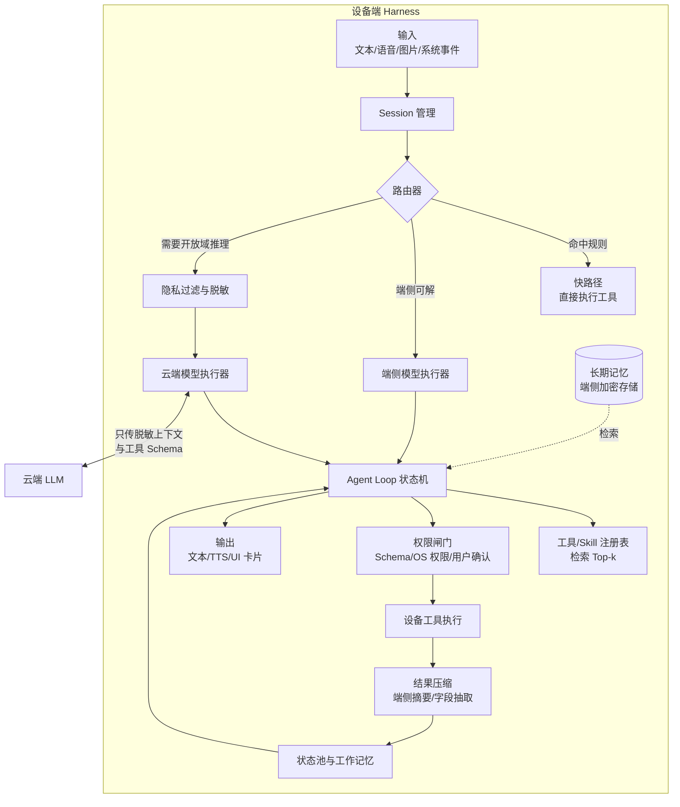
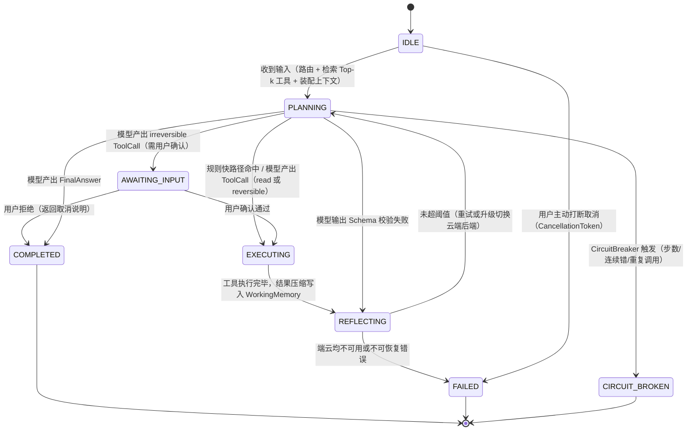
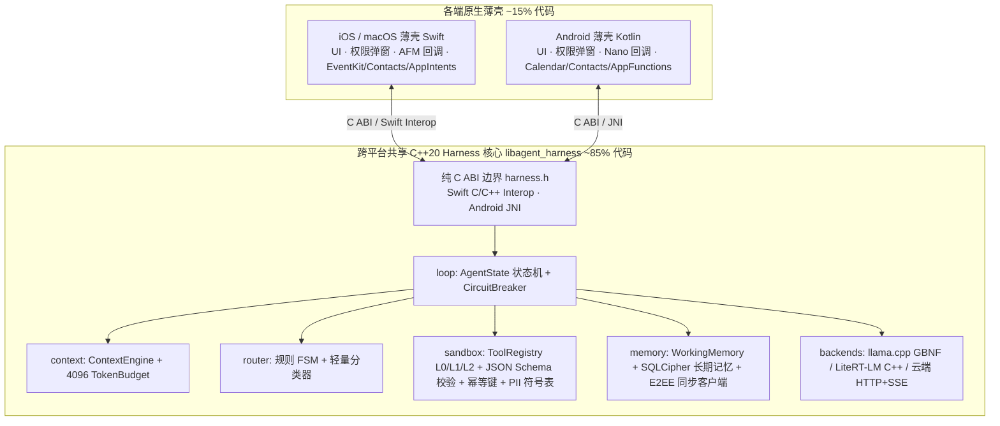

# 端侧大模型 Harness 设计：Android / iOS / Mac 开放助手

> **文档定位**：为 Android、iOS、macOS 三端的**开放式个人助手**设计端侧 Harness（模型以外的确定性工程底座）。本文是设计文档，不含实现代码。
> **前置阅读**：[`ai-agent-harness-architecture.md`](ai-agent-harness-architecture.md)（Harness 通用分层）、[`AGENT.md`](../../AGENT.md)（仓库六大工程准则）。
> **资料时间**：2026-11。厂商 API 多处于 preview/beta，落地前需按官方文档复核。标注【推断】的内容未经官方资料或实测验证。

---

## 一、问题定义

### 1. 目标

- **平台**：Android、iOS、macOS。
- **形态**：开放式助手，用户输入不限领域，需要多轮对话、调用设备能力（日历、文件、通知、联系人等）、查询外部知识。
- **核心诉求**：隐私数据尽量不出设备；离线可用基础能力；低延迟；云端成本可控。

### 2. 结论先行

1. **纯端侧不能完成开放助手**。系统级端侧模型上下文小（Apple 端侧模型每 session 4096 token），参数量在 2–5B 级别，开放域知识与长程规划能力不足。架构必须是**端云混合**：端侧负责路由、隐私、设备工具执行与短任务，云端负责开放域推理。
2. **Harness 的主体在端侧**，无论模型在哪里推理。会话、上下文装配、工具注册与执行、权限闸门、记忆都在设备上；模型只是可替换的后端。PalmClaw 采用的就是这种结构（loop 在手机上，推理走用户配置的 LLM API）。
3. **跨三端共享一份 C++20 Harness 核心（~85% 代码），Swift / Kotlin 只做平台薄壳（~15%）**。这与 [`AGENT.md`](../../AGENT.md) 第 7 条准则完全一致：状态机、熔断器、上下文预算、路由器、PII 脱敏、加密记忆与同步、以及自下载模型推理（`llama.cpp` / `LiteRT-LM` C++ API）全部在 C++ 核心内完成；Swift（iOS/macOS）与 Kotlin（Android）只负责 UI、系统权限弹窗、系统内置模型回调与系统原生工具执行。

---

## 二、现成方案盘点

### 1. 平台系统级方案

| 方案 | 平台 | 模型 | Harness 相关能力 | 关键限制 |
|:---|:---|:---|:---|:---|
| [Foundation Models framework](https://developer.apple.com/foundation-models-framework) | iOS / iPadOS / macOS / visionOS | Apple 端侧模型；Private Cloud Compute；任意遵循 `LanguageModel` 协议的模型（Claude、Gemini、MLX、Core AI） | Tool calling、guided generation（`@Generable` 约束输出）、**Dynamic Profiles**（同一 session 内切换模型/工具/指令，transcript 共享）、Evaluations framework、Instruments 的 token 分析、`fm` CLI 与 Python SDK | 端侧模型 **4096 token/session**，超出抛 `contextSizeExceeded`；官方建议每次请求**只给 3–5 个工具**；模型随 OS 升级变化，需回归 prompt |
| [foundation-models-utilities](https://github.com/apple/foundation-models-utilities) | Apple 平台 / 部分 Linux | 同上 | 实验性抽象：Skills、历史裁剪（`DropCompletedToolCalls`、`RollingWindow`、`SummarizeHistory`）、OpenAI Chat Completions 兼容的 `LanguageModel` | 仍为 beta |
| [ML Kit GenAI](https://developers.google.com/ml-kit/genai) `GenerativeModel` | Android | Gemini Nano 2/3/4（AICore 系统服务） | 自定义 prompt、结构化输出、客户端管理多轮与工具声明 | **仅前台可用**（后台或前台服务调用返回 `BACKGROUND_USE_BLOCKED`）；每 App 推理配额（`BUSY`、电量日配额）；Nano 版本因机型而异，输出可能不同 |
| [ML Kit GenAI `AgentRunner`](https://developers.google.com/ml-kit/genai/agent/android) | Android | Gemini Nano | 托管 agent loop、`AgentSession` 多轮、以 **Android AppFunctions** 声明工具、`maxTurns`（默认 10） | Preview，需加入 AICore Developer Preview；首次推理加载模型可能约 1 分钟 |
| [LiteRT-LM](https://developers.google.com/edge/litert-lm/api_overview) | Android / iOS / macOS / Web / Linux | 自带模型（Gemma 4、MiniCPM5 等 `.litertlm`） | Kotlin / Swift / Python / JS / C++ SDK；tool calling；constrained decoding；thinking token 预算；GPU 加速 | 模型需随 App 分发或下载；Gemma 4 E2B 在部分设备上内存 <1.5GB |
| llama.cpp / MLX | 全平台 / Apple Silicon | 任意 GGUF / MLX 模型 | GBNF 语法约束、OpenAI 兼容 server（适合 Mac） | Harness 需自建 |

### 2. 可参考的 Harness 实现

| 项目 | 平台 | 值得借鉴 | 注意 |
|:---|:---|:---|:---|
| [Google AI Edge Gallery · Agent Skills](https://github.com/google-ai-edge/gallery/tree/main/skills) | Android / iOS | `SKILL.md`（frontmatter 的 name + description 进 system prompt，命中后再加载正文）；JS skill 在隐藏 webview 中执行（`run_js`）；Native App Intents | 演示性质，非生产框架 |
| [PalmClaw](https://github.com/ModalityDance/PalmClaw)（[论文](https://arxiv.org/abs/2607.13027)，EMNLP 2026 Demo） | Android（Kotlin） | 设备能力封装为结构化工具；schema 校验 + Android 权限 + 用户确认 + workspace 边界；AgentLoop / ContextBuilder / MemoryConsolidator / SubagentManager 分层；MCP；cron / heartbeat | **推理走云端 API**，不是端侧模型；AGPL-3.0 |
| [pocket-agent](https://github.com/Armaganakcann/pocket-agent) | Android（Termux + llama.cpp） | 针对 4B 模型的 loop 经验：**链式工具调用不可靠，每轮只做一次调用**；脚本化后端测 loop | 早期项目 |

### 3. 端侧模型候选（自下载控制 ≤ 3B）

**为什么 3B 模型也要 1.5GB 左右？**
每个参数在 4-bit 量化下占 0.5 字节，加上分组量化的 scale/zero 开销（实际约 4.5 bit/参数），以及词表 embedding 层（128k 词表通常保留 8-bit 甚至更高精度，单这一层就要几百 MB），算下来：
$$\text{文件体积} \approx N_{\text{params}} \times 0.55\text{ B} + \text{Embedding 开销}$$
所以 2–2.6B 模型的 4-bit 包在 **1.1–1.6GB** 是物理下限；想压到 **500–800MB**，参数量必须降到 **0.8–1.2B**。

| 档位 | 模型 | 参数量 | 4-bit 文件体积（实测/官方） | 与 Harness 相关的特点 |
|:---|:---|:---|:---|:---|
| 系统内置（0 下载） | Apple 端侧模型 | 系统托管 | 0 MB | 4096 上下文；iOS/macOS 直接用 |
| 系统内置（0 下载） | Gemini Nano | 系统托管 | 0 MB | 仅部分 Android 机型、仅前台可用 |
| 极小档（~500–800MB） | [Qwen3.5-0.8B](https://huggingface.co/unsloth/Qwen3.5-0.8B-GGUF) | 0.8B | Q4_K_M **508 MB**（IQ3_XXS 380 MB） | 适合做路由/分类/槽位抽取；多步工具调用能力弱【推断】 |
| 极小档（~500–800MB） | [LFM2.5-1.2B-Instruct](https://huggingface.co/LiquidAI/LFM2.5-1.2B-Instruct-GGUF) | 1.2B | QAD-Q4_0 **664 MB** / Q4_K_M **697 MB** | 支持 tool calling；32K 上下文；LFM Open License v1.0（需法务核查商用条款） |
| 极小档（~500–800MB） | [MiniCPM5-1B](https://huggingface.co/litert-community/MiniCPM5-1B) | 1B | LiteRT int4 **0.79 GB** | 128K 上下文；官方提供 `.litertlm` 包；int4 包默认 KV cache 1024 |
| 主力档（~1.0–1.6GB） | [LFM3-1.7B](https://huggingface.co/LiquidAI/LFM3-1.7B) | 1.73B | 4-bit 约 **1 GB**（官方模型卡） | 专为 OpenClaw / Hermes / Pi 等 harness 后训练；256K 上下文；16 语言含中文 |
| 主力档（~1.0–1.6GB） | [Qwen3.5-2B](https://huggingface.co/unsloth/Qwen3.5-2B-GGUF) | 2B | Q4_K_M **1.22 GB**（IQ4_XS 1.09 GB） | 中文与多模态；支持 tool use |
| 主力档（~1.0–1.6GB） | [MiniCPM5-2B](https://github.com/OpenBMB/MiniCPM/blob/main/docs/deployment/litert.md) | 2.52B | LiteRT int4 **1.55 GB**（Galaxy S26 GPU 峰值内存 1.14 GB，16–18 tok/s） | 官方实测 Android/iOS/Mac；注意 **int4 开启 thinking 时容易跑满上下文不收敛，端侧工具调用应设 `thinking=false`** |
| 主力档（~1.0–1.6GB） | [LFM2.5-2.6B](https://huggingface.co/LiquidAI/LFM2.5-2.6B-GGUF) | 2.6B | QAD-Q4_0 **1.48 GB** / Q4_K_M **1.56 GB** | 在真实 harness 中做过 Agentic RL |
| 边界说明 | [Gemma 4 E2B](https://developers.googleblog.com/bring-state-of-the-art-agentic-skills-to-the-edge-with-gemma-4/) | 有效 2B / **总参 5.1B** | LiteRT 2/4-bit 内存 <1.5GB | 含 per-layer embeddings 总参超 3B，但是 LiteRT-LM 官方一等公民，视"3B"按有效参数还是总参数计决定去留 |

**模型格式与 C++ 引擎的对应关系**：
- **GGUF 模型**（Qwen3.5、LFM2.5、LFM3）→ C++ 核心直接链接 **`llama.cpp`**，使用 GBNF 语法树强约束 JSON 输出；
- **`.litertlm` 模型**（MiniCPM5、Gemma 4）→ C++ 核心链接 **`LiteRT-LM` C++ SDK**（或通过其内置 constrained decoding 约束输出）。
- 两者在 C++ 核心内部统一封装为同一个 `IModelBackend` 接口，按所选模型打包对应引擎即可（默认推荐 `llama.cpp` + GGUF，一套 C++ 代码同时跑通 Mac / iOS / Android）。

## 三、约束如何决定设计

| 约束 | 事实来源 | 设计后果 |
|:---|:---|:---|
| Apple 端侧 4096 token/session | Apple 文档 | 不能把对话历史一直堆进 session；端侧调用必须**短 session、按任务开新 session**，状态由 Harness 外置 |
| 每次请求 3–5 个工具 | Apple 文档 | 工具必须先检索后注入；全量工具清单不能进 prompt |
| Android 系统模型仅前台可用、有配额 | ML Kit 文档 | 后台任务（定时、通知触发）不能依赖 Gemini Nano，需自带模型（LiteRT-LM）或走云端；`BUSY` 需退避或降级 |
| 系统模型版本随机型/OS 变化 | ML Kit、Apple 文档 | 评测必须按"模型版本"分桶；prompt 需随系统升级回归 |
| 首次加载可能达分钟级 | AICore 文档 | 需要预热策略与"模型未就绪"的降级路径（规则或云端） |
| 小模型多步链式调用不可靠 | pocket-agent 经验、Apple "split tool usage across sessions" 建议 | 多步任务由 Harness 状态机推进，模型每步只做一次决策 |
| 端侧 prefill 慢 | Gemma 4 博客：Raspberry Pi 5 CPU 上 prefill 133 tok/s | 固定前缀复用 KV cache；动态内容后置；工具结果先压缩再入上下文 |

---

## 四、总体架构



**核心思想**：云端模型可以"规划并发出工具调用"，但工具**永远在设备上执行**，并经过设备侧权限闸门；工具结果在回传云端前，先在端侧压缩或脱敏。

---

## 五、模块设计

### 1. 模型后端抽象（`IModelBackend`）

C++ 核心对外只依赖一个纯虚接口（C ABI 导出为函数指针表），**核心契约是"模型只产出结构化决策，绝不在模型 SDK 内部自动执行工具"**：

```
StepDecision = ToolCall { tool_name, args_json } | FinalAnswer { text }
```

| 后端类型 | 运行位置 | 实现方式 | 如何保证"只返回决策、不自动执行工具" |
|:---|:---|:---|:---|
| 自下载模型（GGUF） | C++ 核心内部（三端通用） | 直接链接 `llama.cpp` C/C++ API | 用 **GBNF 语法树**将输出强制约束为 `StepDecision` 的 JSON Schema |
| 自下载模型（`.litertlm`） | C++ 核心内部（三端通用） | 链接 `LiteRT-LM` C++ SDK | 用 constrained decoding 输出 `StepDecision` JSON，**不使用** `Conversation` 的自动 tool loop |
| Apple 系统内置模型 | Swift 薄壳经 C ABI 回调 | `FoundationModels` `LanguageModelSession` | **不使用 `Tool` 协议自动回调**；改用 `@Generable` 定义 `StepDecision` 结构体，单步返回给 C++ 核心 |
| Android 系统内置模型 | Kotlin 薄壳经 JNI 回调 | ML Kit `GenerativeModel` | 使用结构化输出或客户端工具声明（只取 function call 意图），**生产路径不使用 `AgentRunner`** |
| 云端模型 | C++ 核心内部（或 Apple PCC） | C++ HTTP/SSE 客户端（OpenAI Chat Completions 兼容） | `tools` 参数声明 Schema，收到 `finish_reason: "tool_calls"` 后交回 C++ 状态机 |

**Session 复用与 4096 上下文恢复策略**：

- **同一任务内优先复用同一个底层 Session**，以命中底层 KV Cache，并在 Apple 端配合 **Dynamic Profiles** 在端侧与云端 profile 之间切换；
- 当 C++ `ContextEngine` 预估本轮输入 + 输出预留将超过 `capabilities().context_size`（Apple 端侧为 4096），或底层返回 `contextSizeExceeded` 时，C++ 核心用状态池摘要**重建一个新 Session**（对应 Apple 官方 `init(model:tools:transcript:)` 恢复模式）后继续当前步骤。

### 2. 路由器（Router）

三级决策，**硬性原则：不能为了路由去冷启动唤醒端侧大模型**：

1. **规则快路径（< 5ms）**：高频、明确的指令（"定个 7 点闹钟""打开蓝牙"）在 C++ 内用正则 / 前缀树 / FSM 直接解析执行，不经过 LLM。
2. **轻量分类（< 20ms）**：
   - 若端侧模型**未热驻内存**：仅使用 C++ 内置规则 + 关键词/轻量向量匹配直接判定去向，绝不阻塞等待模型加载；
   - 若端侧模型**已热驻内存**：可用极小 prompt + 结构化输出 `{intent, needs_private_data, complexity, needs_web}` 辅助判定。
3. **执行位置决策**：

| 条件 | 去向 |
|:---|:---|
| 单步设备操作、参数可从输入直接提取 | 端侧模型 |
| 涉及本地个人数据的总结与问答（短文本） | 端侧模型 |
| 离线 / 云端不可用 / 用户关闭云端 | 端侧模型 + 能力受限提示 |
| 开放域知识、长文档、多步规划、代码 | 云端模型（经脱敏） |
| 端侧模型输出校验失败 ≥1 次 | 升级到云端 |

路由策略做成**跨端共享的配置**（阈值、意图表），各平台读取同一份配置。

### 3. 上下文装配（Context Assembler）

1:1 对应本仓库 [`core/context/ContextEngine`](../../core/context/__init__.py) 与 `TokenBudget`，并针对 Apple 端侧 4096 上限做端侧特化：

- **前缀字节绝对静止**：`system_prompt` + 当前步骤筛选出的工具 Schema（≤ 5 个）固定在最前；时间、电量、网络状态等动态信息统一放进 `<status_bar>`，追加在**最新一轮用户消息尾部**（与 `core/context` 第 28–32 行完全一致）。
- **状态外置**：对话真相保存在 C++ `WorkingMemory` 状态池，不依赖模型 Session 的隐式历史；Session 因 4096 溢出重建时，直接从状态池装配。
- **端侧 4096 Token 预算分配**（遵循 `TokenBudget`，中文按 1 字 ≈ 1 token 计，留 300 token `safety_margin`，【推断】具体比例需实测微调）：

| 区段 | 预算（tokens） |
|:---|:---|
| `system_prompt_reserve`（system + ≤5 个工具 Schema） | 750 |
| 长期记忆检索结果 | 450 |
| 最近对话摘要 + 最近 2 轮原文 | 1100 |
| 当前用户输入 + 上一步工具压缩结果 + `<status_bar>` | 950 |
| `max_output_tokens`（单步决策输出预留） | 500 |
| `safety_margin`（分词误差安全余量） | 346 |
| **合计** | **4096** |

- **工具结果确定性压缩**：工具返回原始数据后，先由 C++ 按 Schema 做确定性字段白名单抽取与长度截断（零模型开销）；仅当用户明确要求总结长文档时，才单开一个临时 Session 做摘要。
- 云端调用切换为大号 `TokenBudget`（如 32K/128K），同样遵守静态前缀规则以命中云端 Prompt Cache。

### 4. 工具与 Skill 注册表

- **统一定义格式**：采用 `SKILL.md`（frontmatter：`name`、`description`；正文：使用说明）+ JSON Schema 工具定义。该格式与 Gallery、PalmClaw、Claude 系 harness 一致，三端共享同一份文件。
- **三级渐进披露**（对应 `AGENT.md` 的 L0/L1/L2）：
  - L0：全部 skill 的一行描述只进入检索索引，**不进 prompt**；
  - L1：检索 Top-3~5 的工具 Schema 进 prompt；
  - L2：示例与边界说明仅在该工具被选中且参数校验失败后注入。
- **平台绑定**：同一工具名在各端映射到原生实现：

| 工具类别 | iOS / macOS | Android |
|:---|:---|:---|
| 应用内能力 | App Intents【推断：可作为工具实现层】 | AppFunctions |
| 日历 / 联系人 / 提醒 | EventKit、Contacts | Calendar / Contacts Provider |
| 文件 | 沙箱目录 + 用户授权的 security-scoped URL | SAF / 应用私有目录 |
| 通知 / TTS | UserNotifications、AVSpeechSynthesizer | NotificationManager、TextToSpeech / ML Kit TTS |
| 自定义逻辑 | JS（JavaScriptCore / WKWebView） | JS（WebView），参考 Gallery `run_js` |
| 外部服务 | MCP client / HTTP | 同左 |

- **副作用分级**：每个工具声明 `effect: read | reversible | irreversible`。`irreversible`（发消息、删除、支付）强制用户确认，并注入 `idempotency_key`。

### 5. Agent Loop 状态机（对齐 `core/loop`）

严格复用本仓库 [`core/loop/AgentState`](../../core/loop/__init__.py) 的 8 个标准状态与 `CircuitBreaker` 熔断器，不另起炉灶：



**与 `core/loop` 的 1:1 映射与端侧规则**：

- **单步单动作**：每次 `PLANNING` 调用模型只产出一个 `StepDecision`（端侧模型禁止链式/并行调用；云端模型仅允许并行调用 `read` 工具）。
- **熔断器参数（`LoopConfig`）**：完全复用 `CircuitBreaker.record_action(action_signature, is_error)`——端侧 profile 设 `max_steps = 8`【推断】、云端 profile 设 `max_steps = 20`，`consecutive_error_limit = 3`、`identical_call_limit = 2`（连续两次相同参数调用立刻进 `CIRCUIT_BROKEN`）。
- **幂等键**：所有 `reversible` / `irreversible` 工具调用在进入 `EXECUTING` 前，由 C++ 核心按 `core/sandbox/generate_idempotency_key(action_name, payload_hash)` 注入唯一幂等键。
- **流式与打断（Cancellation）**：每次请求绑定一个 `CancellationToken`。语音插话或用户点停止时：立即中断底层推理流（`llama.cpp` abort callback / Swift Task cancel / Kotlin Job cancel）；正在执行的 `read` 工具直接丢弃结果，已执行的 `reversible` 工具在状态池标记可回滚。
- **前后台生命周期**：App 切后台时，若当前使用的是 Android `Gemini Nano`（后台会被阻塞），在 `REFLECTING` 阶段自动将后端切换为 C++ 内的自下载模型或云端继续执行，或将状态池落盘挂起。

### 6. 记忆与跨端同步

- **工作记忆**：当前会话状态池（结构化 KV + 最近轮次），只存端侧，不同步。
- **长期记忆**：用户画像、偏好、事实，存端侧加密数据库，用端侧 embedding 检索（Android 可用 ML Kit Embeddings + AppSearch；Apple 可评估 Core Spotlight）。
- **写入治理**：遵循 `AGENT.md`，会话中只生成"记忆提议"，在空闲时（充电、Wi-Fi）由离线任务合并与去冲突。
- **云端推理可见性**：长期记忆默认不发给云端推理服务；路由到云端时，只传与当前请求相关、经脱敏的片段。
- **跨设备同步（Android + iOS + Mac 端到端加密）**【推断：以下为工程设计方案】：
  - 因为要跨 Apple 与 Android，不能只用 iCloud/CloudKit，需要自建轻量同步服务（只存密文 blob）。
  - **加密**：每条记忆记录在端侧用对称密钥（如 AES-GCM / XChaCha20-Poly1305）加密后再上传；服务端只有 `{record_id, version, deleted, ciphertext, updated_at}`，看不见明文。用户密钥由账号密码派生（Argon2id）或新设备扫码配对传递。
  - **只同步结构化明文，不同步向量**：不同端可能跑不同 embedding 模型（或不同版本），向量跨端不可比。各端拉取密文解密后，在本地后台重算 embedding 入库。
  - **冲突消解**：记忆以原子事实为单位（`{id, key, value, updated_at, source_device}`），更新走增量日志 + LWW（最后写入胜出）或按字段合并；删除用 tombstone。

### 7. 隐私与安全

- **结构化脱敏与工具参数反解**：
  - 发往云端前，C++ 脱敏层用本地规则 + 实体词典识别手机号、地址、联系人姓名等 PII，替换为带类型的符号占位符（如 `<PERSON_1>`、`<PHONE_1>`），并在当前会话的**内存符号表**中记录双向映射；
  - 云端若返回普通文本，流式还原占位符；
  - **云端若返回 `ToolCall`**：C++ 核心在进入 `AWAITING_INPUT`（用户确认）和 `EXECUTING` **之前**，先对 `args_json` 的 AST/字段做符号表反解，把 `<PERSON_1>` 还原为真实姓名与号码——**用户确认弹窗看到的一定是还原后的真实参数**；若占位符被模型篡改导致反解失败，直接判为参数校验错误进 `REFLECTING`。
- **提示词注入**：工具结果（网页、邮件、文件内容）一律视为不可信数据，用分隔标记包裹；不可信内容触发的 `irreversible` 工具调用必须用户确认。
- **审计**：每次工具执行记录 `{tool, args 摘要, 来源（端/云）, 确认结果, idempotency_key}`，本地可查看。

### 8. 资源与可用性

- **预热**：App 启动或用户打开助手界面时异步预热端侧模型；未就绪时走规则或云端。
- **降级**：内存告警、温控降频、低电量模式时，切换到更小的模型或云端，并缩短上下文预算。
- **配额**：Android `BUSY` 指数退避；`PER_APP_BATTERY_USE_QUOTA_EXCEEDED` 时当天切换云端或自带模型。


### 9. 自下载模型的分发与档位策略

- **按设备能力与内存自动选档**【推断：阈值需实测】：
  - **iOS / macOS**：启动时检查 `SystemLanguageModel.default.availability`。可用时直接走 Apple 系统内置模型（0 下载）；若机型不支持、用户未开启 Apple Intelligence 或地区受限，则与 Android 同样走 C++ 自下载模型或云端兜底；
  - **Android**：支持 Gemini Nano 且在前台时可选用系统模型；其余机型或需后台执行时，RAM ≥ 8GB 下载 **主力档（1.7B–2.5B，1.0–1.55GB）**，RAM ≤ 6GB 或省空间模式下载 **极小档（0.8B–1.2B，500–800MB）**。
- **首次启动不阻塞**：模型未下载完成前，全部请求走 C++ 规则快路径 + 云端后端；Wi-Fi 下后台断点续传，校验 SHA-256 后热切换。
- **MiniCPM5 实操注意**：按官方 LiteRT-LM 文档，Android 12+ 使用 OpenCL GPU 必须在 `AndroidManifest.xml` 声明 `libOpenCL.so` 与 `libvndksupport.so`；且 int4 包需显式关闭 thinking（`enableThinking = false`），否则容易把 4096 上下文耗尽在思考链上。

---

## 六、跨平台复用架构：C++20 核心 + 原生薄壳

遵循本仓库 [`AGENT.md`](../../AGENT.md) 第 7 条准则与 [`AGENT_FRAMEWORKS_CPP_GO.md`](AGENT_FRAMEWORKS_CPP_GO.md)：**Python `core/` 作为算法与状态机参考基线，生产端侧由一份 C++20 Harness 核心跨 Android / iOS / macOS 100% 复用**。



### 1. 跨语言边界只暴露 2 个回调接口

C++ 核心不感知任何平台框架，平台薄壳在初始化时向 C++ 注册两张函数表：

1. **`NativeModelCallback`**（仅在调用 Apple 内置模型或 Android Gemini Nano 时用到；自下载模型与云端模型直接在 C++ 内部跑，**零跨语言开销**）：
   - `generate_step(prompt_utf8, schema_utf8, cancel_token) -> StepDecisionJson`
2. **`NativeToolCallback`**（执行系统级原生工具）：
   - `invoke_tool(tool_name, args_json, idempotency_key) -> ToolResultJson`
   - `request_user_confirmation(tool_name, restored_args_json) -> bool`

### 2. 与本仓库目录规范对齐

完全归入 [`AGENT.md`](../../AGENT.md) 第二节定义的现有目录，不新建孤立顶层目录：

```
agent/
├── core/                          # Python 参考基线（状态机、上下文、记忆、沙箱的 1:1 规范定义）
│   └── native_cpp/                # 跨三端共享的 C++20 Harness 核心实现 (CMake)
│       ├── include/harness.h      # 纯 C ABI 导出头文件（供 Swift / JNI 调用）
│       ├── src/                   # loop, context, router, sandbox, pii, memory_sync, backends
│       └── third_party/           # llama.cpp / LiteRT-LM / SQLCipher / json Schema
├── tools/                         # 跨端共享的 SKILL.md 与工具 JSON Schema 定义
├── apps/
│   └── personal_assistant/        # 三端开放助手工程壳
│       ├── apple/                 # iOS + macOS 共用 Swift Package / Xcode 工程
│       └── android/               # Android Kotlin 工程 (JNI 绑定 libagent_harness.so)
└── evals/                         # 跨端共享轨迹评测集与前缀回归用例
```

---

## 七、评测

- **分层指标**：路由准确率、工具选择准确率、参数准确率、端到端任务成功率（$Pass^k$）、端侧占比、云端 token 成本、首字延迟、单任务能耗。
- **分桶**：按 `平台 × 模型版本（AFM 版本 / Nano 版本 / 自带模型）× 执行位置` 分桶，系统升级后自动回归。
- **工具**：Apple Evaluations framework 与 Instruments 的 Foundation Models 模板；Android 端参考 ML Kit 的 prompt 评估指南；跨端统一用 `evals/` 下的轨迹用例，Mac 上用开源模型做离线回放。
- **首错定位**：失败轨迹按 `AGENT.md` 的前缀回归方法定位首次偏离步骤，区分路由错、工具选择错、参数错、执行错。

---

## 八、风险与开放问题

| 风险 / 问题 | 影响 | 处理 |
|:---|:---|:---|
| ML Kit `AgentRunner`、AFM 新特性处于 preview / beta | API 变动 | Harness 只依赖最底层的生成与结构化输出接口，托管 loop 不进入生产路径 |
| Gemini Nano 机型覆盖不全、仅前台可用 | 无系统模型或后台场景不可用 | 已定：C++ 核心直接内置自下载 ≤3B 模型推理（1B 档 ~0.7GB / 2B 档 ~1.2–1.5GB） |
| 端侧模型版本漂移 | 同一 prompt 行为变化 | 版本分桶评测，prompt 按模型族版本化 |
| 脱敏导致云端回答质量下降或占位符被破坏 | 体验或工具参数反解失败 | 符号表在网关前结构化反解；反解失败进 `REFLECTING` 重试 |
| 云端规划 + 端侧执行的信任边界 | 云端被注入后操控设备 | C++ 权限闸门不信任任何模型来源，`irreversible` 一律弹窗确认真实参数 |
| Dynamic Profiles 与 4096 上限的交互 | 架构简化程度 | 待实测 |
| 跨端 E2EE 密钥丢失 | 用户换机后无法解密历史记忆 | 需提供恢复码或密码派生密钥方案 |

**已确认决策**：

1. **跨平台核心语言**：采用 **C++20** 实现跨 Android / iOS / macOS 共享的 Harness 核心（`libagent_harness`），与 `core/` Python 基线 1:1 对齐；Swift / Kotlin 仅做 UI、系统模型回调与系统工具薄壳。
2. **云端供应商**：暂不绑定；C++ `IModelBackend` 内置通用 OpenAI Chat Completions HTTP/SSE 客户端，Apple 端可额外桥接 `LanguageModel` 协议 / PCC。
3. **自下载端侧模型**：控制在 **3B 以内**（分 ~0.7GB 极小档与 ~1.0–1.55GB 主力档），在 C++ 核心内通过 `llama.cpp`（GGUF + GBNF）或 `LiteRT-LM` C++ SDK 直接运行。
4. **长期记忆同步**：在 C++ 核心内统一实现 SQLCipher 本地存储 + 端到端加密同步客户端（服务端仅存密文）+ 各端本地重算向量。

---

## 九、分阶段路线

| 阶段 | 内容 | 产出 |
|:---|:---|:---|
| P0 规格与基线 | 在 `core/` 与 `tools/` 下固化工具 Schema、路由配置与评测轨迹 | 共享规格与评测集 |
| P1 C++ 核心 + Mac 验证 | 完成 `core/native_cpp`（状态机、4096 预算、脱敏、记忆同步、`llama.cpp` 后端），在 Mac 上跑通 CLI 与单元测试 | `libagent_harness` 静态/动态库 |
| P2 iOS / macOS 壳 | Swift 薄壳通过 C ABI 接入 `libagent_harness`，挂接 Apple Foundation Models 与 EventKit / Contacts / App Intents | Apple 端云混合可用 |
| P3 Android 壳 | Kotlin 薄壳通过 JNI 接入同一份 `libagent_harness.so`，挂接 Gemini Nano 与 Android 系统工具 | 三端共用同一 C++ 核心，共享评测集对齐 |
| P4 优化 | 离线记忆合并、能耗与温控降级策略、按模型版本回归飞轮 | 上线基线 |

---

*关联文档：[`ai-agent-harness-architecture.md`](ai-agent-harness-architecture.md) · [`AGENT_FRAMEWORKS_CPP_GO.md`](AGENT_FRAMEWORKS_CPP_GO.md) · [`../../perception/edge_platforms/README.md`](../../perception/edge_platforms/README.md) · [`../../apps/cockpit_agent/ReadMe.md`](../../apps/cockpit_agent/ReadMe.md)*
