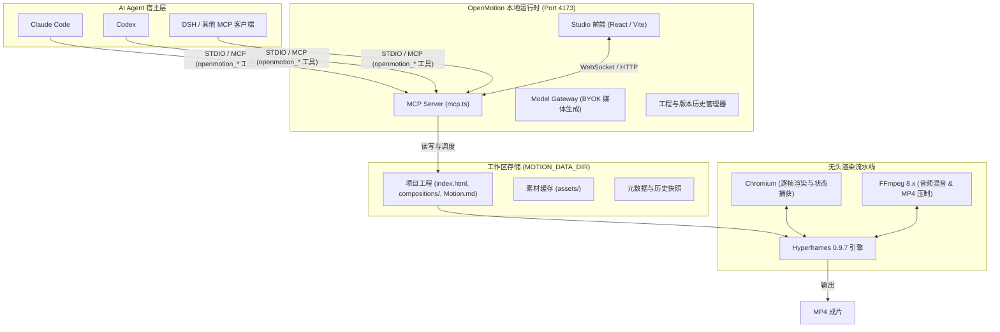

# OpenMotion 本地源码部署与工程实践指南

> 本文档面向工程研发与 AI Agent 开发者，详细说明在 macOS (Apple Silicon / Intel) 及 Linux 环境下，从源码编译部署 OpenMotion 核心服务、运行 Studio 工作台，并将其接入 Claude Code、Codex 等 Agent 的完整流程。

---

## 1. 架构总览与核心设计

OpenMotion (`nexu-io/openmotion`) 采用 **Video as Code** 架构理念，将视频拆解为基于 Web 标准（HTML、CSS、JavaScript/GSAP）构建的可视化时间轴工程，结合结构化规范 `Motion.md`，由 Agent 进行逻辑理解与自动化编排。



---

## 2. 硬件与前置依赖要求

### 2.1 依赖项清单

| 依赖软件 | 最低版本要求 | 推荐配置 | 作用说明 |
| :--- | :--- | :--- | :--- |
| **macOS / Linux** | macOS 14+ / Ubuntu 22.04+ | macOS Darwin 24+ (Apple Silicon) | 运行环境 |
| **Node.js** | `>= 22.18.0` | Node.js `24.x` 或 `26.x` | 需支持 `--experimental-strip-types` |
| **npm** | `>= 10.x` | 与 Node.js 配套最新版 | 锁定版本安装 (`npm ci`) |
| **FFmpeg & ffprobe** | `>= 4.4` | FFmpeg `7.x` / `8.x` | 音频波形解析、无头音视频编码与混流 |
| **Google Chrome / Chromium** | 稳定版 | 最新稳定版 | Studio 承载、无头逐帧画面捕获 |
| **Git** | `>= 2.30` | 建议配置禁用 LFS 自动下载 | 代码版本拉取 |

### 2.2 本机环境校验命令

在部署前，可通过以下命令快速确认本机关键依赖状态：

```sh
# 1. 检查 Node.js 与 npm
node -v   # 必须 >= 22.18.0
npm -v

# 2. 检查 FFmpeg 与 ffprobe
ffmpeg -version | head -n 1
ffprobe -version | head -n 1

# 3. 检查 Chrome 路径（macOS 典型路径）
ls -l "/Applications/Google Chrome.app/Contents/MacOS/Google Chrome"
```

若 macOS 未安装 FFmpeg，可通过 Homebrew 安装：
```sh
brew install ffmpeg
```

---

## 3. 一键部署与全自动脚本

在当前仓库根目录下提供了全自动部署与服务管理脚本 [deploy_openmotion.sh](file:///Users/fx/wk/github/agent/scripts/deploy_openmotion.sh)。

### 3.1 脚本使用方法

```sh
# 赋予执行权限
chmod +x scripts/deploy_openmotion.sh

# 1. 仅检查当前环境与依赖状态（预检）
./scripts/deploy_openmotion.sh --check-only

# 2. 一键安装部署（默认目标目录为 /Users/fx/wk/github/openmotion）
./scripts/deploy_openmotion.sh

# 3. 自定义目标路径与端口并立即启动服务
OPENMOTION_DIR="/custom/path/openmotion" PORT=4173 ./scripts/deploy_openmotion.sh --start
```

---

## 4. 手动本地源码部署步骤

若需手动控制构建与调试过程，可依序执行以下步骤：

### 步骤 1：克隆源码仓库

OpenMotion 包含许多示例与演示媒体（通过 Git LFS 托管），为了节省带宽与加快拉取速度，建议禁用 LFS smudge 过滤器并使用浅克隆：

```sh
# 定义部署路径
TARGET_DIR="/Users/fx/wk/github/openmotion"

git -c filter.lfs.process= -c filter.lfs.smudge= -c filter.lfs.required=false \
  clone --depth 1 --single-branch --branch main \
  https://github.com/nexu-io/openmotion.git "$TARGET_DIR"

cd "$TARGET_DIR"
```

### 步骤 2：安装锁定依赖

OpenMotion 严格依赖 Hyperframes `0.9.7` 和 GSAP `3.15.0`，请使用 `npm ci` 确保与 `package-lock.json` 完全一致：

```sh
npm ci
```

### 步骤 3：编译 Studio 前端

Studio 基于 React 与 Vite 构建，包含内联组件、模板卡片及模板指南的编译：

```sh
npm run build:studio
```

> **构建产物验证**：执行成功后，确认生成了 `studio/build/index.html`。

### 步骤 4：配置核心环境变量

OpenMotion 依赖无头 Chromium 与 FFmpeg 二进制路径，并将用户工程数据保存在代码目录之外以避免污染。推荐在 `$TARGET_DIR` 下创建环境配置文件 `.env`：

```sh
cat << 'EOF' > .env
# 浏览器绝对路径（无头捕获与 Studio 预览）
MOTION_BROWSER_PATH="/Applications/Google Chrome.app/Contents/MacOS/Google Chrome"

# FFmpeg 与 FFprobe 绝对路径
HYPERFRAMES_FFMPEG_PATH="/opt/homebrew/bin/ffmpeg"
HYPERFRAMES_FFPROBE_PATH="/opt/homebrew/bin/ffprobe"

# 用户项目与凭据数据持久化目录
MOTION_DATA_DIR="$HOME/.openmotion/data"

# 本地服务端口
PORT=4173
EOF
```

---

## 5. 服务启动与生命周期管理

### 5.1 启动 Studio 预览服务

```sh
# 方式 1：前台启动
npm start

# 方式 2：使用 node 直接启动并载入环境
node --env-file=.env --experimental-strip-types preview.ts
```

启动成功后，终端将输出：
```
OpenMotion preview server listening on http://localhost:4173
```
浏览器打开 [http://localhost:4173](http://localhost:4173) 即可进入包含 800+ 视频模板与实时时间轴编辑器的 OpenMotion Studio。

### 5.2 启动独立 MCP 服务

若作为 MCP 守护进程被外部 Agent 唤起：

```sh
node --env-file=.env --experimental-strip-types mcp.ts
```

---

## 6. 接入 AI Agent (omp / Cursor / Windsurf / Claude Code / Codex)

OpenMotion 后端暴露的是基于 **Model Context Protocol (MCP)** 标准的 `stdio` 接口（入口为 `mcp.ts`）。**MCP 是一项开放通用协议，绝不仅限于 Claude Code**，任何支持 MCP 协议的 Agent 客户端均可直接接入并获得完整的 34 个视频编排与工程工具能力。

在部署目标目录下，已自动生成标准配置文件：`mcp_server_config.json`。

```json
{
  "mcpServers": {
    "openmotion": {
      "command": "node",
      "args": [
        "--experimental-strip-types",
        "/Users/fx/wk/github/openmotion/mcp.ts"
      ],
      "env": {
        "MOTION_DATA_DIR": "/Users/fx/.openmotion/data",
        "MOTION_BROWSER_PATH": "/Applications/Google Chrome.app/Contents/MacOS/Google Chrome",
        "HYPERFRAMES_FFMPEG_PATH": "/opt/homebrew/bin/ffmpeg",
        "HYPERFRAMES_FFPROBE_PATH": "/opt/homebrew/bin/ffprobe"
      }
    }
  }
}
```

### 6.1 接入 omp (Oh My Prompt)

omp 原生支持通过 MCP 协议动态挂载与调用工具：
1. **stdio Server 模式**：
   在 omp 的 MCP 注册配置中添加 `openmotion` 服务，命令与参数指向本机 Node 与 `mcp.ts`，并注入对应环境变量。
2. **生效验证**：
   在 omp 提示词中可直接通过 `openmotion_*` 调用，例如：
   - `openmotion_list_templates`（列出可用视频模板）
   - `openmotion_create_project`（创建视频工程）
   - `openmotion_edit_project`（编辑时间轴与动效代码）
   - `openmotion_export_request`（触发无头渲染导出 MP4）

### 6.2 接入通用 IDE Agent (Cursor / Windsurf / Cline / Roo Code)

直接将上述 `mcp_server_config.json` 中的 `mcpServers.openmotion` 配置段粘贴至各客户端的 MCP 设置中：
- **Cursor**: 在设置中的 `Features -> MCP Servers` 添加，或写入项目根目录 `.cursor/mcp.json`
- **Windsurf**: 写入 `~/.codeium/windsurf/mcp_config.json`
- **Cline / Roo Code**: 在 VS Code 插件的 MCP 设置中导入或写入 `cline_mcp_settings.json`

### 6.3 接入 Claude Code

修改或创建 `~/.claude/mcp.json`（或项目级 `.claude/mcp.json`），使用生成的 `claude_mcp_config.json`：
在 Claude Code 终端运行 `/mcp`，确认 `openmotion` 状态显示为 `connected`。

### 6.4 接入 Codex (OpenAI Codex CLI)

使用 OpenMotion 内置的 Codex 本地插件安装指令：

```sh
cd /Users/fx/wk/github/openmotion
bash scripts/install-motion.command
```

---

## 7. 常用工程验证与无头渲染

### 7.1 验证项目构建与导出

在无头环境下，可通过命令行直接验证视频工程的渲染流程：

```sh
# 验证导出流程完整性
npm run verify:export
```

### 7.2 渲染指定工程为 MP4

使用内置的 Hyperframes CLI 对工程进行无头逐帧捕获与音视频压制：

```sh
# 在项目目录下
npx hyperframes render \
  --project "$HOME/.openmotion/data/projects/my-video" \
  --output "$HOME/.openmotion/data/projects/my-video/output.mp4" \
  --fps 60 \
  --quality high
```

---

## 8. 常见问题排查 (Troubleshooting)

### Q1: `Cannot find Chrome binary` 或 `Browser launch timed out`
- **原因**：Puppeteer / Hyperframes 无法在默认系统路径定位到 Chromium。
- **解决**：在 `.env` 中显式设置 `MOTION_BROWSER_PATH` 或 `HYPERFRAMES_BROWSER_PATH`，确保路径指向可执行文件（macOS 下为 `.app/Contents/MacOS/Google Chrome`）。

### Q2: 渲染 MP4 导出无声或时间轴波形提取失败
- **原因**：FFmpeg / FFprobe 缺失或架构不匹配（例如 x86 二进制在 arm64 下运行缺少 Rosetta）。
- **解决**：确认 `which ffprobe` 存在，且版本与 ffmpeg 一致（Apple Silicon 推荐 `/opt/homebrew/bin/ffprobe`）。在 `.env` 中设置 `HYPERFRAMES_FFPROBE_PATH`。

### Q3: 端口 4173 冲突被占用
- **原因**：已有 Studio 实例未关闭。
- **解决**：
  ```sh
  # 查找占用进程
  lsof -i :4173
  # 关闭冲突进程
  kill -9 $(lsof -t -i :4173)
  ```

### Q4: GSAP 动画与时间轴拖动（Scrubbing）不同步
- **原因**：在组件内使用了原生的 `setTimeout`、`requestAnimationFrame` 或非受控异步定时器。
- **解决**：所有动效必须依附于 Hyperframes 传入的 `timeline` 对象，通过 GSAP 帧推进控制。
