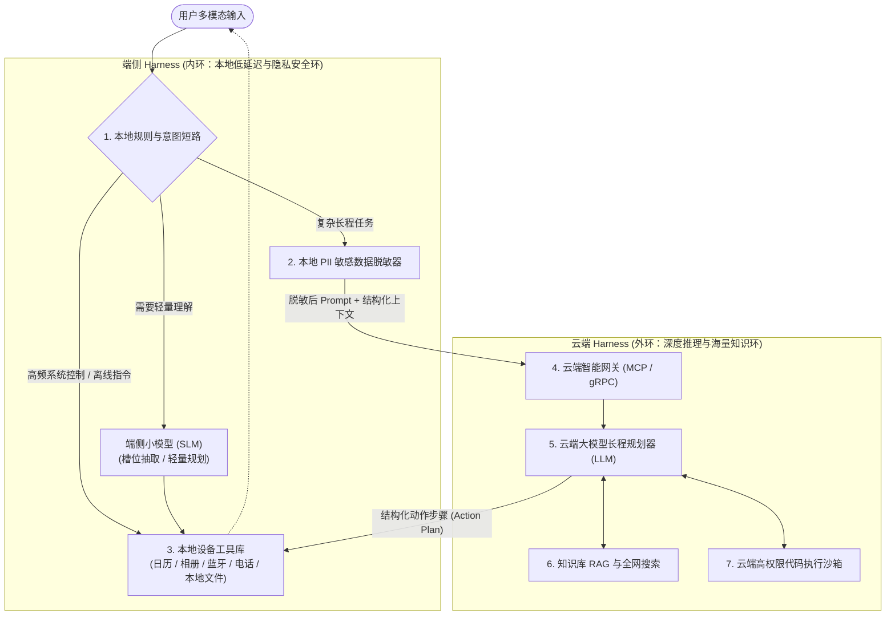

# 端侧与云端 AI Agent Harness 的区别、联系与端云协同架构

> **文档定位**：深度对比运行在**端侧（手机/车机/PC/边缘计算）**与**云端（Kubernetes/微服务集群）**的 Agent Harness 在架构设计、工程约束、核心选型上的本质差异，并深入剖析现代生产级系统普遍采用的**端云协同双环（Dual-Loop）Harness 架构**。

---

## 一、 端侧 Harness：在极端物理约束下的精密工程

端侧（On-Device / Client-Side）直接运行在用户的物理终端设备上（如 Android 手机、iPhone、MacBook、智能座舱车机或具身机器人）。与拥有无限弹性的云端不同，端侧是一场“戴着镣铐跳舞”的硬核系统工程。

```
+-----------------------------------------------------------------------------------+
|                            端侧 Harness 的核心物理约束                              |
|                                                                                   |
|  1. 内存预算严苛  : 移动端物理内存有限，模型+底盘常被限定在 1.5GB ~ 2.5GB 内，防 OOM 强杀   |
|  2. 上下文极窄    : 端侧 SLM 上下文通常仅 2K ~ 4K Token (如 Apple 限制 4096 / Session)    |
|  3. 工具容量极小  : 单次 Prompt 仅能稳定挂载 3 ~ 5 个轻量工具，超出则召回率急剧恶化       |
|  4. 电量与发热    : NPU/GPU 持续高负荷推理会导致芯片过热降频 (Thermal Throttling) 与掉电   |
|  5. 操作系统限制  : 严格受制于 OS 权限（iOS TCC / Android 权限）与后台冻结机制           |
+-----------------------------------------------------------------------------------+
```

### 1. 核心设计原则：低线束税（Low Harness Tax）
在端侧，Harness 自身的代码体积、内存常驻与 CPU 占用必须无限趋近于零。
* **语言与运行时选型**：严禁在端侧直接打包庞大的 Python 解释器或重量级 Node.js 运行时。主流方案为**跨平台纯 C++20 / Rust 打造核心工程内核（占据 ~85% 逻辑）**，通过 JNI / C-FFI 向宿主暴露接口，在 Android（Kotlin）和 iOS/macOS（Swift）端仅编写约 15% 的轻量原生平台适配层（UI、系统权限弹窗、原生系统意图）。
* **极速冷启动**：内存常驻不能超过几十 MB，启动时间必须控制在毫秒级。

### 2. 本地意图短路与规则仲裁（Fast Intent Arbiter）
端侧用户交互强调“即刻响应”（<100ms）。端侧 Harness 会建立严格的分级拦截管道：
1. **正则与前缀树规则匹配（<5ms）**：如用户说“音量调大”、“打开手电筒”，直接被本地规则短路并执行系统调用，绝不进入大模型推理；
2. **端侧微模型分类/抽取（20~50ms）**：0.8B~1.5B 级别的小模型负责意图识别与槽位提取；
3. **复杂跨域任务**：端侧处理不了的高级需求，脱敏后异步打上标记移交给云端。

### 3. 上下文精打细算与工具降维
由于端侧模型（如 Gemini Nano、Apple 端侧模型、LFM-1.7B）普遍受限于 4096 tokens 的上下文窗口，端侧 Harness 必须：
* **动态精选工具**：不能把全量系统功能一次性丢进 Prompt，而是根据上一轮意图，每次仅向模型提供 3~5 个最相关的工具描述；
* **单步单工具执行策略**：端侧小模型对链式连续工具调用（Chained Tool Calling）的理解力极弱，容易幻觉。端侧 Harness 通常强制执行“一轮只调用一个工具，拿到结果立即返回”的保守策略；
* **激进的历史裁剪**：每次工具返回大段数据（如联系人列表、日程文件），Harness 在喂给模型前必须在端侧提取出 3~5 个关键字段，原始冗余数据绝不入上下文。

---

## 二、 云端 Harness：高并发、超长程与企业级可靠性

云端（Cloud-Side）运行在企业自建机房或公共云弹性算力集群上，面向千万级并发用户与复杂的商业级长程业务。

```
+-----------------------------------------------------------------------------------+
|                            云端 Harness 的核心系统特征                              |
|                                                                                   |
|  1. 算力与内存充沛 : 依托 H100/A100 GPU 集群与分布式内存，支撑 128K ~ 2M 超长上下文     |
|  2. 分布式会话状态 : 跨节点 Agent Session 持久化，支持任务长时间中断、恢复与异步排队   |
|  3. 动态沙箱容器化 : 每次代码生成或终端执行均在独立的 Docker / Firecracker 微虚机中运行  |
|  4. 复杂多 Agent 协同 : 支撑主管、执行者、评审员多角色并行交互 (Actor 模型 / 图编排)      |
|  5. 弹性容灾与路由 : 具备跨模型供应商 (OpenAI/Anthropic/DeepSeek) 自动 Fallback 与降级   |
+-----------------------------------------------------------------------------------+
```

### 1. 分布式运行时与长周期状态机
云端任务（如 SWE-bench 解决 GitHub Issue、自动撰写全行业研报）往往需要执行数十步甚至几小时。
* **Durable Execution（持久化执行）**：Harness 底座（如采用 LangGraph 或类似 Temporal 机制）在每一步执行前后都将完整的 Graph 状态快照持久化至 PostgreSQL 或 Redis。即使工作节点发生故障漂移，也能实现从断点无缝拉起。
* **并发会话与锁机制**：保证同一个用户的同一个 Agent 实例在高频并发交互时不会发生状态竞态。

### 2. 企业级沙箱与环境拟真
云端 Agent 拥有强大的代码编写和系统操作权限，必须确保环境严格隔离：
* **微轻量虚拟化（MicroVM）**：为每个任务实例动态拉起独立的 Docker 或 Firecracker 轻量虚拟机沙箱，提供完整的 Linux 根文件系统、网络隔离与磁盘配额；
* **ACI（Agent-Computer Interface）工程**：针对云端智能体设计结构化的辅助命令行工具（如针对大文件的按页查看工具 `view_file <start_line> <end_line>`、针对仓库的全局符号检索），避免模型盲目执行全量 `cat` 导致上下文暴涨。

### 3. 多模型容灾路由与成本治理
云端 Harness 是企业成本与可用性的总把关人：
* **自动降级熔断**：当主力大模型遭遇 API 速率超限（429 Too Many Requests）或服务瘫痪（503）时，Harness 在 50ms 内无缝将请求转发至备用厂商模型；
* **Prompt 缓存与成本对冲**：通过严格维护静态 Prompt 前缀静止，充分利用云端供应商的 KV-Cache Discount 机制，节约 50%~80% 账单成本。

---

## 三、 端侧与云端 Harness 全方位对比矩阵

| 对比维度 | 端侧 Harness (On-Device) | 云端 Harness (Cloud-Side) |
|:---|:---|:---|
| **典型宿主环境** | 手机 (iOS/Android)、Mac/PC、智能座舱、IoT | Kubernetes 集群、Serverless 容器、高并发后端服务 |
| **底层开发语言** | C++20 / Rust（核心引擎）+ Swift / Kotlin（系统薄壳） | Python（主流）、Go、TypeScript、Rust |
| **内存与算力占用** | 必须压至极致（<50MB 常驻，低线束税），防 OOM | 资源充沛，重点在分布式内存利用与高并发吞吐 |
| **匹配模型量级** | 端侧系统模型或自下载 SLM（0.8B ~ 4B 级别） | 百亿至千亿级超大模型（70B ~ 400B+、深度思考模型） |
| **上下文窗口限制** | 极小（2K ~ 4K / 8K Token） | 超大（128K ~ 2M Token） |
| **工具挂载能力** | 建议单步 **3 ~ 5 个轻量工具**，避免模型迷失 | 可同时编排数十个工具，支持动态多层工具树 |
| **工具调用可靠性** | 弱（多步链式调用易崩溃，推荐每轮单步执行） | 强（支持多步循环、自主编写复杂脚本验证） |
| **沙箱隔离手段** | 操作系统原生权限体系（TCC / Android 权限闸门 / 进程 UID） | Docker 容器、gVisor、Firecracker 微虚机 |
| **核心业务价值** | **极致低延迟、离线可用、个人敏感隐私数据绝不离端** | **长程高难度推理、多智能体协作、全网海量知识计算** |
| **最大痛点与挑战** | 设备算力发热、内存碎片被杀进程、OS 后台限制 | 并发服务器成本高昂、API 速率受限、数据合规监管 |

---

## 四、 终极方案：端云协同双环（Dual-Loop）Harness 架构

纯端侧无法独立承载高难度开放推理，纯云端无法获取设备底层的实时上下文并保障绝对隐私。因此，现代工业界最顶级的 Agent 架构必然是**端云协同双环架构**：



### 端云协同的三大关键交互机制

1. **隐私安全下沉（PII 脱敏与本地闸门）**：
   在向云端发包前，端侧 Harness 内置的规则与小型实体识别模型（NER）会自动识别用户的身份证号、具体通讯录姓名、金融账单数据，将其替换为匿名占位符（如 `<PERSON_1>`、`<PHONE_1>`）。真实数据仅留存在端侧内存中。
2. **大脑在云，手脚在端（Cloud-Brain & Edge-Hands）**：
   云端大模型扮演顶层规划专家，输出严密的结构化执行计划（JSON / AST 格式的操作序列）；端侧 Harness 拿到计划后，根据本地操作系统的授权状况逐条执行本地 API（如将行程写入本地日历、唤醒原生导航），并将执行结果（脱敏后）回传给云端确认。
3. **通信协议标准：全面拥抱 MCP（Model Context Protocol）**：
   现代端云协同正全面转向 Anthropic 提出的 **MCP 协议**。端侧将手机自带的硬件与原生能力抽象为标准化的 MCP Server，云端作为 MCP Client 发起安全调用，实现跨操作系统、跨网络边界的标准工具互联。
