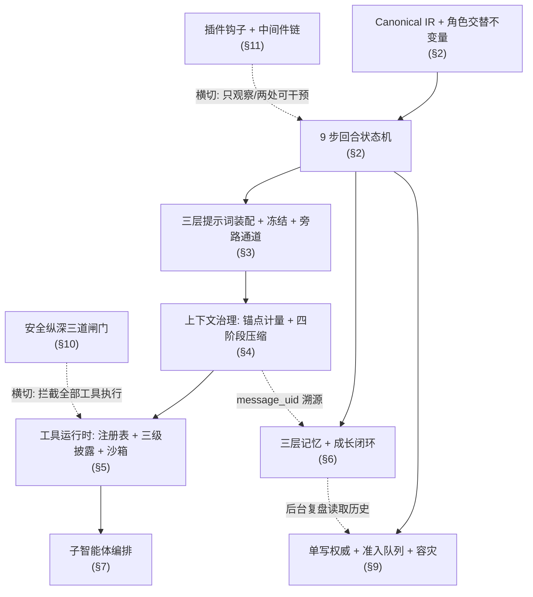

# Harness 开发者实施手册：模块技术问题的工程决策与实现规格

> **文档定位**：站在 **Harness 开发者**的视角重写 [04 号深度解析](04_hermes_agent_harness_deep_dive.md)。04 号回答"Hermes 是怎么做的、为什么"；本篇回答"**我要从零建一套生产级 Harness，每个模块必须做哪些决策、按什么规格实现、哪些坑必须绕开**"。所有参数直接引用 Hermes 的生产值作为起步基线，可按自身场景等比调整。
>
> 每个模块统一按四栏展开：**痛点**（不做会怎样）→ **决策**（你作为开发者要拍板的架构选择）→ **实现规格**（带具体参数的落地要求）→ **坑**（实测/业界踩过的坑）。

---

## 0. 总则：六条开发公理

开始写任何模块之前，先把自己钉死在六条公理上，后文所有模块决策都由它们推导：

| # | 公理 | 开发者含义 |
|---|---|---|
| 1 | **提示词绝对稳定** | System Prompt 会话启动时一次构建即冻结，中途绝不原地改——前缀缓存命中要求逐字节一致 |
| 2 | **执行过程全可观测** | 用结构化钩子 + 无副作用回调暴露内部状态，核心循环不依赖任何 UI 库 |
| 3 | **任意时刻安全可中断** | 流式生成中、并发工具执行中都可中断，且消息历史不留脏状态（配对闭合） |
| 4 | **核心彻底平台无关** | 编排内核不知道自己在 CLI、桌面端还是 IM 网关里跑，只按能力元数据调整输出格式 |
| 5 | **注册表松耦合** | 工具/插件/记忆提供方/上下文引擎全部注册表自发现；**"一个插件需要修改核心文件才能工作"即架构异味** |
| 6 | **配置与状态全隔离** | 配置、凭据、SQLite、技能库、网关 socket 全部收敛进单一 `$HERMES_HOME`，多实例零冲突并行 |

以及一条贯穿全文的元原则：

- **每个动态状态都有固定的注入位置和冻结语义**（防缓存击穿）；
- **每个无界资源都有硬上限或生命周期淘汰**（防膨胀）；
- **每个可失败组件都有确定性降级路径**（防硬崩溃）；
- **一切副作用收口于单写权威**（防脑裂 / 重放）。

---

## 1. 拓扑：单核窄腰

**痛点**：CLI、TUI、桌面端、IDE 插件、25+ IM 平台、Cron 各写一套胶水循环 → 提示词拼法分叉、权限逻辑不一致、会话历史无法跨端接续，维护灾难。

**决策**：

1. **上层入口彻底薄化**：所有前端只做协议收发、界面渲染、阻塞确认，**严禁**包含任何 Prompt 拼接、上下文裁剪、工具编排逻辑。
2. **中层单一编排内核**：所有入口收敛到同一个平台无关的同步状态机（Hermes: `AIAgent`，由 `run_agent.py` 外观层委托给 `agent/conversation_loop.py`）。
3. **底层资源插件化**：Provider、执行沙箱、上下文压缩器、记忆提供方全部抽象基类（ABC）+ 注册表。

**规格**：

- 一个核心 = 一个回合状态机（见 §2），入口只是它的"驱动器"。
- 本地入口发现常驻网关在线时，**自动退化为薄附着客户端**（见 §7），不再自行运行编排循环。

**坑**：最隐蔽的分叉不在代码里，而在"每个入口各自刷新 System Prompt"——只要有一处多拼了一行时间戳，该入口就永远吃不到缓存折扣，且与网关会话的 prompt 前缀分裂。

---

## 2. 控制回路（Orchestration Loop）：9 步回合状态机

**痛点**：教科书 ReAct 的 `while True` 会在生产环境死于四个边界：① 多模型线协议异构；② 流式中断造成角色交替污染（连续两条同角色消息 / 悬挂 `tool_call` → 各家 API 直接 400）；③ 顽固报错引发无限重试或"只输出思考链不输出正文"的空转；④ 第 30 轮撞上 429/402/5xx 整条任务链报废。

**决策**：

- **单一内部中间表示（Canonical IR）**：历史、压缩器、数据库只维护一套规范化消息列表；协议适配下沉到"发起 HTTP 请求的前一刻"，响应收到立即归一化回 IR。
- **两条角色交替不变量**（作为不变式在写历史前强制校验）：
  - 对话流：`user → assistant → user → assistant`，严禁连续同角色；
  - 工具流：`assistant(含 tool_calls) → tool(按原始请求顺序一一对应) → assistant`。
- **中断即丢弃（Discard-on-Interrupt）**：流式 HTTP 放后台守护线程，主线程轮询中断事件；中断则丢弃残缺 Assistant 响应、绝不写历史，并对未完成 `tool_call` 合成结构化占位结果，保证配对闭合。

**规格（9 步回合状态机，对应 Hermes `agent/turn_*.py` 正交模块）**：

| Step | 职责 | 规格要点 |
|---|---|---|
| 1 | 任务初始化 | 生成 `task_id`，重置中断标志，初始化原子 `IterationBudget`（主 Agent `max_turns=500`，子 Agent `delegation.max_iterations=250`），追加 user 消息 |
| 2 | System Prompt | 查 `_cached_system_prompt`，命中则零开销复用；仅首跑或完整压缩重建后重新构建并冻结（见 §3） |
| 3 | Preflight 水位预检 | 发请求前检查 token 水位，越界先压缩再重建冻结 prompt（见 §4） |
| 4 | 插件钩子 + 窗口投影 | `pre_llm_call` 仅首个内层迭代触发：可注入临时上下文、动态收窄工具集；再经 `context_engine.select_context()` 投影 |
| 5 | 线协议适配 | 内部 IR → 三种 API 模式之一：`chat_completions` / `codex_responses` / `anthropic_messages` |
| 6 | 临时覆盖层 | `_apply_ephemeral_context()`：瞬态信号只注入**本次 HTTP 载荷副本**，请求结束即销毁，绝不落盘历史 |
| 7 | 缓存断点 | 对 Anthropic / OpenRouter-Claude 自动放 4 个 `cache_control` 断点（`system_and_3` 策略，省约 75% 输入成本） |
| 8 | 可中断流式调用 | `_interruptible_api_call()` 后台流；`incomplete_response` 最多自动续写 3 次，仍无进展触发 `_try_activate_fallback` 切供应商 + 凭据池轮转 |
| 9 | 终结分支 | A) 有 `tool_calls`：线程池并发/屏障串行执行，按原序写回 `role:tool`，跳回 Step 5；B) 纯文本：`pre_verify` 完成度校验 → 输出转换 → 写 `state.db` → 增量微压缩 → 异步拉起后台复盘（见 §6） |

---

## 3. 提示词装配与前缀缓存经济学

**痛点**：一次会话 20~100 次连续 LLM 调用，System Prompt + 工具 Schema 占 10k~30k tokens。每轮动态刷新 prompt（时间戳、pwd、git 分支、技能列表拼进头部/中部）→ 第 100 个 token 变一个字符，其后数万 token 的 KV Cache 瞬间全部失效。

**决策**：三层装配 + 冻结 + 旁路通知。

**规格**：

| 层级 | 内容（拼接顺序） | 防击穿设计 |
|---|---|---|
| `stable`（跨会话静态） | Agent 身份（`$HERMES_HOME/SOUL.md` 或默认）、工具行为指南、平台排版约束 | 完全不依赖目录与会话状态 → 该用户所有会话最前端 100% 相同 token 序列 |
| `context`（项目共享） | `system_message` → 项目上下文文件（**首个命中即胜出**：`.hermes.md`/`HERMES.md` ≻ `AGENTS.md` ≻ `CLAUDE.md` ≻ `.cursorrules`，向上递归至 git 根）→ git 工作区快照 | **关键排序**：项目文件严格排在任何含 CWD/Worktree 路径的行之前，使多 worktree 并发 Agent 共享缓存前缀；注入文件过威胁扫描（防提示注入）；单文件 >20,000 字符做保首尾截断（头 70% + 尾 20%） |
| `volatile`（会话快照，置末尾） | `<available_skills>` 索引、`MEMORY.md`/`USER.md` 冻结快照、外部 Memory Provider 静态块、时间戳/模型名/`# Hermes runtime environment` 边界标记 | 会话内**保持冻结**：中途改 `MEMORY.md`、装新技能都不刷新此层 |

- **冻结语义**：Turn 1 构建后，直到发生完整压缩重建前严禁修改。
- **单次用户消息旁路通道**：环境跳变（跨端切换 `agent/surface_switch.py`、技能目录增删 `agent/skills_index_delta.py`）一律封装成一段 `[System Note]` 一次性附加到**下一条 user 消息**，绝不回改 System Prompt。
- **CI 快照防膨胀**：`scripts/ci/prompt_surface.py render` 对 9 种典型配置渲染完整 System Prompt + Tool Schemas 存基准快照（`tests/fixtures/prompt_surface/`），每次 PR 自动 diff token 增减量——这是防止团队在迭代中无意膨胀基础 prompt 的唯一可靠手段。

**坑**：最容易破功的不是 System Prompt，而是"往历史中间插一条系统消息"——同样击穿其后全部缓存。所有瞬态信息只能走 Step 6 临时层或旁路通道。

---

## 4. 上下文窗口治理

**痛点**：本地分词器估算与真实消耗偏差 20%~50%（"以为没满直接 400"）；一次 web 抓取灌入数万 token 稀释信号；一刀切摘要 2~3 轮后把用户硬约束、精确路径、commit SHA 概括成套话；等到 85% 再同步全量摘要 → 15~40 秒交互卡顿。

**决策**：真实回执锚定计量 + 双层水位防线 + 四阶段压缩 + 增量微压缩。

**规格**：

1. **双层水位防线**
   - 外层网关卫生预检（`gateway/run_turn_hygiene.py`）：实例化 Agent 前按固定 **85%** 兜底拦截；
   - 内层引擎自适应阈值（`agent/context_compressor.py`）：默认 **50%** 触发；窗口锁死 272K 的高阶模型（Codex OAuth 下 `gpt-5.4/5.5/5.6`、`Astra`）自动上调至 **85%（约 231K）**。
2. **计量**
   - `agent/usage_anchor.py`：以最近一次 API 真实 `prompt_tokens + completion_tokens` 为锚点，仅对锚点后新增消息做本地增量估算；首跑/换模型/回滚后第一轮走 `should_defer_preflight_to_real_usage()` **等真实回执**，防误判。
   - `agent/image_token_cost.py`：未获知前按每张图 **1,500 tokens** 保守预估，首次视觉调用后用真实回执减文本估算，学习每个 `model@host` 的单图真实残差并缓存。
3. **四阶段压缩**
   - **P1 零成本修剪**：保护尾部之外，>200 字符的旧 `tool` 输出替换为 `[Old tool output cleared to save context space]`，已加载技能正文替换为 `[SKILL_PRUNED: <name> — reload with skill_view if needed]`。**若修剪后已降至阈值下，跳过 LLM 摘要**。
   - **P2 协议安全切分**：保护头部前 `protect_first_n=3` 条；尾部 `lean` 模式仅保留窗口 2.5%（钳制 10,000~25,000 tokens，且至少含 `min_tail_user_messages=1` 条真实用户消息——500K 窗口下约 49K，传统模式 162K）；`_align_boundary_backward()` 回滑切分点，**绝不把 `assistant(tool_calls)` 与对应 `tool` 结果切在边界两侧**。
   - **P3 结构化摘要**：固定 7 章节（`## Goal` / `## Constraints & Preferences` / `## Progress` / `## Key Decisions` / `## Relevant Files` / `## Next Steps` / `## Critical Context`）+ **确定性正则机械锚点索引**（PR 号、commit SHA、文件路径、错误码）+ 被压缩区段内真实用户消息原样附于摘要；迭代重压缩在此结构上原地演进。
   - **P4 原地提交**：`session_id` 不变，SQLite 旧消息标 `active=0, compacted=1`，写入摘要行，CLI 与 IM 网关无缝延续。
4. **延迟隐藏**
   - 预备压缩（`agent/prepared_compaction.py`，`prepare_ahead: true`）：水位进入阈值下方 12% 区间即后台预计算摘要，下轮越界毫秒级替换；超时按 **60s → 300s → 900s** 阶梯冷却，连续 2 次超时降级为**确定性无 LLM 摘要**。
   - 微压缩（`agent/micro_compactor.py`，`compression.micro_compact: true`）：每回合 `finalize_turn` 只吸收最老一组 Assistant 交互进滚动摘要标记，**永久跳过 User 消息原样保留**；滚动摘要超 `micro_compact_defrag_threshold_tokens=2000` 自动碎片整理 → 长会话水位稳定在 **~22%** 直线，消灭锯齿卡顿（代价：每轮重写摘要标记使其后缓存失效，适合重低水位场景）。
5. **跨压缩身份追踪**：`ContextEngine` 为每条消息分配持久化 32 位 hex `message_uid`，摘要上维护 `absorbed_message_uids` 与 `_tool_call_uids`，外部图谱/DAG 记忆插件可追溯任意结论的原始出处。

---

## 5. 工具运行时与认知卸载

**痛点**：工具 >50~100 个时，全量 JSON Schema 占 20k~50k tokens 且显著拉低选择准确率；"搜 10 个文件→逐个读→过滤→汇总"要 15~20 个 LLM 往返；后台编译任务被模型每几秒轮询一次 `poll`，白烧几十个回合。

**决策**：三级渐进披露 + 代码执行沙箱 + 空轮询自动转异步。

**规格**：

1. **导入期自注册**：`model_tools.py` 导入 `tools/*.py` 时自动向全局单例 `tools/registry.py` 注册 Schema / 处理函数 / 环境可用性检查器，不维护集中枚举表。
2. **分发策略**：
   - 绝大多数工具经 `registry.dispatch()` 在 `ThreadPoolExecutor` 并发执行，**完成后严格按模型请求原序写回**；
   - `todo`、`memory`、`session_search`、`delegate_task` 四个有状态核心工具由 `AIAgent` 主循环**直接拦截**执行（安全读写会话内部状态）；
   - `clarify`（用户交互）与长耗时 MCP 调用为**串行屏障**独占执行。
3. **三级渐进披露**（MCP 工具、插件工具、`computer_use`/`session_search` 等大 Schema 低频工具）：
   - Tier 1 小规模 → 全量暴露；Tier 2 中等 → 桥接工具 + 单行目录清单；Tier 3 超大规模 → 仅桥接工具；
   - 桥接工具三个：`tool_search`（关键词检索）、`tool_describe`（加载完整 Schema 并提升为会话热工具）、`tool_call`（间接调用）；
   - **透明解包**：`tool_call(name=...)` 执行前还原为真实工具名，使下游钩子、危险命令审批、并发策略与直接调用完全一致；
   - 收益（引 Anthropic 基准）：约 50 个 MCP 工具时工具调用准确率 **49% → 74%**，同时省数万固定 token。
4. **`execute_code` 编程式卸载**：
   - 模型在 `execute_code` 里写 Python 脚本，`from hermes_tools import web_search, web_extract, read_file, write_file, search_files, patch, terminal`；
   - 运行时每次执行自动生成临时 `hermes_tools.py` 桩模块，子进程经 **Unix Domain Socket**（Windows 回退本地回环 TCP；远程沙箱走文件 RPC）回调父进程真实工具运行时；
   - 安全边界：单脚本硬超时 **300s**、嵌套工具调用上限 **50 次**、禁止沙箱内递归 `delegate_task`/`execute_code`、自动剥离 API Key 环境变量、仅 **≤50KB** 的 stdout 进入模型上下文；
   - 效果：15 轮往返 / 50k 中间 tokens 的操作折叠为**单次 LLM 回合**，中间原始输出零字节进窗口。
5. **执行沙箱 7 后端**：`local` / `docker`（单容器跨回合跨子 Agent 持久复用，强制 `--read-only` 根 FS、`--cap-drop ALL`、`--pids-limit 256`、`tmpfs` 隔离）/ `ssh` / `modal` / `daytona` / `vercel_sandbox`（退出拍快照、下次恢复）/ 插件 `singularity`、`sprites`。
6. **防轮询**：`process_wait_auto_notify` 开启后，对同一后台进程连续 **2 次空轮询**自动注册 `notify_on_complete`，并在工具返回中明确命令模型停止轮询、结束本回合等待唤醒。

---

## 6. 记忆系统与成长闭环（Multi-Tier Memory & Self-Improvement）

**痛点**：① 核心元偏好（"不要输出代码片段"）靠向量检索召回不了——语义检索对具体技术问题命中不了全局偏好；反之无脑往常驻文件追加，几个月后膨胀成数万 token 垃圾场。② 陈述性事实（"用户有一台 128GB 的 Mac Studio"）与程序性 SOP（"如何排查某框架编译报错"）混塞一个池子，前者浪费上下文。③ 同步反思阻塞用户等待；本地推理时后台复盘线程又抢下一轮提问的 GPU。

**决策**：认知科学三层记忆金字塔 + 异步自省 + 生命周期淘汰，三层全部防膨胀，成长走异步。

### 6.1 Tier 1：核心工作记忆（定长双文件）

- `MEMORY.md`（环境事实、项目约定）硬限 **2,200 字符（约 800 tokens）**；`USER.md`（用户画像、沟通偏好）硬限 **1,375 字符（约 500 tokens）**。
- 会话启动时作为**冻结快照**全量注入 System Prompt 易变层（固定开销约 1,000~1,500 tokens）。
- **溢出强制整理**：`memory(action="add")` 超限 → **直接拒绝写入**，返回当前全部条目及字符占比，强制模型在**同一次**工具调用里用 `operations` 批量原子操作（组合多条 `remove` + `replace`）完成去重提炼。拒绝追加而非自动裁剪，是"让模型承担整理决策"的关键设计。
- **双层安全**：写入内容先过正则注入扫描（拦截伪造系统指令/越狱载荷）；工具输出回传模型前自动脱敏 API 密钥与 token。

### 6.2 Tier 2：情景检索（零常驻成本）

- 所有历史会话实时同步至 SQLite `~/.hermes/state.db`，双索引：
  - **FTS5**：Porter 词干分词 + BM25 排序，管自然语言；
  - **Trigram**：精确子串匹配，管骆驼拼写函数名、报错码、文件路径。
- `session_search` 检索约 **20ms**；命中后由**廉价辅助模型**浓缩为 **500 字高密度摘要**回传主模型；`scroll` 操作约 **1ms** 在命中位置前后滑动看原文——全程不污染主上下文窗口，**0 常驻 token**。

### 6.3 Tier 3：程序性技能库（渐进披露）

- 遵循开放 `agentskills.io` 规范，每技能一目录：带 YAML Frontmatter 的 `SKILL.md` + 可选 `references/`、`templates/`、`scripts/`、`assets/`。
- 三级按需加载：**L0** 系统提示词仅列名称 + 单行描述（约 **3,000 tokens**）→ **L1** `skill_view(name)` 加载正文与关联文件清单 → **L2** `skill_view(name, path)` 读具体章节/脚本。
- 压缩时已加载技能正文被替换为 `[SKILL_PRUNED: <name> — reload with skill_view if needed]`（§4 P1），需要时重载。

### 6.4 成长闭环：后台复盘 → Linter 防退化 → Curator 生命周期

**沉淀（Background Review Fork）**：

- 每经过设定轮次，回合 `finalize_turn` 后在**后台**派生只读复盘分支，权限白名单仅 `memory`、`skill_manage`、`skill_view`、`session_search`（无 `terminal`、无 `send_message`——提炼新偏好写 T1、新 SOP 写 T3，但碰不到执行与对外通道）。
- 三个成本技巧：
  1. **热缓存复用**：复盘用与主会话相同模型时，克隆父会话完整历史 + 末尾追加复盘指令 → 100% 命中刚生成的服务商 Prompt Cache；
  2. **轻摘要投喂**：配廉价辅助模型（`auxiliary.background_review`）时，先把长历史压缩为精简摘要（≤ 模型窗口 75% 且 ≤ 600K tokens）再发；
  3. **本地 GPU 让行**（`defer: auto`）：检测到本地推理服务（`llama-server`）时自动推迟到主对话空闲，不与用户下一轮实时提问争显存。

**防退化（Advisory Skill Linter，静态检查器，每次创建/修补技能自动跑）**：

| 检查 | 防什么 |
|---|---|
| `incident-log-shape` | 技能文档退化成流水账式排错日记 |
| `references-sprawl` | `references/` 下文件数 > 60 警告 |
| `oversized-body` | `SKILL.md` 正文 > 24,000 字符警告 |

**生命周期（Curator 馆长，`agent/curator.py`）**：

- 定期审计所有 Agent **自主创建**的技能，按使用频率 + 近期采纳率划分 `active → stale → archived`，stale 自动移入 `.archive/`；**人工创建的技能永久豁免**。
- 效果：`<available_skills>` 索引永不膨胀——这是"成长"与"防膨胀"能同时成立的唯一方式：**只淘汰机器造的，永不淘汰人审的**。

### 6.5 知识蒸馏与外部记忆

- `/learn`：整本 EPUB/PDF、文档站点或 GitHub 仓库蒸馏为技能包——顶层 `SKILL.md` 作总目录索引，`references/` 存按章节拆分的精炼文档，`sources.json` 记录源文件路径或 Git Commit SHA 供增量更新。
- `MemoryProvider` ABC（`agent/memory_provider.py`）：可挂 RetainDB、ByteRover、Honcho、OpenViking、Mem0、Hindsight、Holographic、Supermemory、Memori 等第三方图谱/向量记忆系统；**静态块走 System Prompt 易变层，动态检索结果走 API 调用期临时层**——外部记忆同样服从缓存经济学。

---

## 7. 子智能体编排（Subagent Delegation）

**痛点**：① 传父历史给子 Agent → 噪音 + 烧 token；不传 → 5 个并发子 Agent 各自冷启动 Prefill，缓存白丢。② 多个编码子 Agent 并发改同一目录 → 工作区踩踏。③ 固定"最长 10 分钟"总超时 → 误杀推进中的长任务，又放过真死循环。④ 子 Agent 再派生孙 Agent（指数爆炸）/擅自向用户发消息/改全局记忆（越权）。

**决策**：零历史隔离 + 共享缓存前缀 + 单层扁平树 + 心跳停滞检测 + 物理隔离。

**规格（`tools/delegate_tool.py`）**：

| 机制 | 规格 | 解决的问题 |
|---|---|---|
| 缓存友好隔离 | 子 Agent 仅收 `goal` + `context` + `output_schema`；System Prompt 复用父级项目上下文前缀顺序 | 子任务高信噪比 + 直接命中父会话已预热的 KV Cache |
| 叶子工具硬封禁 | 子 Agent 强制禁用 `delegate_task`（防递归）、`clarify`（防阻塞交互）、`memory`（防污染全局 `MEMORY.md`）、`send_message`（防外部副作用）、`cronjob` | 所有对外交互与持久状态变更收口主智能体 |
| 输出契约 | `output_schema` JSON Schema；不符合时自动执行 **1 次有界修正重试**，返回 `structured_output` + `schema_valid` 标志 | 像强类型函数一样可靠消费子 Agent 结果 |
| 停滞监控器 | 双状态空闲监控替代固定总超时：思考空闲 **450s**（达 80% 即 360s 时注入警告引导收尾）/ 工具执行中 **1,200s**；触发后给 **120s** 宽限汇总部分结果，超时终止 | 长任务可跑数小时，挂死任务精准优雅回收 |
| Worktree 隔离 + 实时控制 | `worktree_isolation: true` 自动建 `.worktrees/subagent-<id>`，结束后清理未修改分支；异步模式支持 `steer`（注入新指令，若恰在注入前结束标 `missed_steer`）、`interrupt`、`status`、`handoff`（移交最多 3 个后台进程） | 并发改文件物理隔离 + 运行时动态纠偏、免销毁重来 |
| 独立完成 + 崩溃恢复 | `independent_completions` 按 `group` 聚合唤醒；持久化子任务崩溃恢复按五级策略处置：`AUTO_AT` / `AUTO_ON_BOOT` / `ON_FIX` / `REPAIR_THEN_CONTINUE` / `HANDOFF` | 慢子任务不拖住整批快子任务；网关重启不丢任务 |

---

## 8. 错误停止（Fault Termination）：五道独立防线

开发者最常低估的模块。核心纪律：**所有失败路径必须有降级，不允许裸 `raise` 杀死整条任务链；所有有副作用的路径必须有防重放；所有不可逆动作必须 fail-closed。**

| 防线 | 故障域 | 机制与参数 |
|---|---|---|
| **1. 迭代预算** | 长程死循环 / 空转 | 原子计数器两级：主 Agent `max_turns=500`、子 Agent `max_iterations=250`；**预算耗尽时先切供应商，再授予备用模型单次有界宽限调用（1 Bounded Grace Call）**汇总进展体面收尾，而非硬崩 |
| **2. 供应商故障转移** | 429 / 402 / 5xx / 上游宕机 | Fallback chain；`incomplete_response`（如 codex 只回思考块无正文）最多自动续写 **3 次**仍无进展才切 `_try_activate_fallback`；CredentialPool 四策略：`fill_first` / `round_robin` / `random` / `least_used` |
| **3. 中断即丢弃** | 用户中断破坏协议 | 后台守护线程跑流式 HTTP，主线程轮询中断事件；中断即丢弃残缺 Assistant 响应、未完成 `tool_call` 合成占位结果 → 历史恒满足角色交替不变量（§2） |
| **4. 停滞检测** | 子智能体挂死 | 心跳进度（最后一次实质进展：API 响应或工具调用完成）：思考空闲 450s / 工具中 1,200s；先带外警告促收尾 → 120s 宽限 → 终止（§7） |
| **5. 崩溃防重放** | 网关崩溃重启 | `session_admissions` 表三态状态机 `queued → started → completed/unknown`：恢复时 `queued` 可安全自动唤醒；**`started`（工具可能已产生外部副作用）严禁自动重放**，标记 `unknown` 并**挂起该会话后续队列**等人工确认 |

**降级路径纪律（不硬崩清单）**：

- 预备压缩超时：60s → 300s → 900s 阶梯冷却，连续 2 次超时 → 降级**确定性无 LLM 摘要**；
- FTS 索引损坏：解耦触发器，`session_search` 降级 `LIKE`，后台空闲重建（核心写入不受影响）；
- 主库物理损坏：隔离旧库 + `.jsonl` 应急转储未落盘消息 + 毫秒级新建库继续服务（§9）；
- 迭代预算耗尽：宽限调用收尾（防线 1）；
- 子任务崩溃：五级恢复策略（§7）。

---

## 9. 状态一致性与容灾

**痛点**：多端（CLI/桌面/手机 IM/车载）+ Cron 同时附着同一会话 → 双写脑裂、消息序号错乱、`SQLITE_BUSY` 锁死；网关在"工具已执行、回合未收尾"时断电 → 重启重放 = 邮件发两遍/转账两遍；FTS5 虚拟表非正常关机易损坏 → 检索抛异常拖垮全部消息写入。

**规格**：

1. **单写者权威（Single-Writer Authority）**：
   - 同一会话/状态目录同一时刻只有一个长驻网关进程持直接执行权 + 数据库主写权；
   - 网关在 `$HERMES_HOME/gateway.sock`（权限锁死 `0600`）暴露控制面，`SO_PEERCRED`（Linux）/ `getpeereid`（macOS/BSD）在**操作系统层**校验调用方 UID；
   - 校验通过签发 **30 秒有效、单次使用**的随机票据（Ticket），CLI 凭票据升级至 `/api/ws` WebSocket 双工流。
2. **Epoch 栅栏**：`runtime_State` 表维护单调递增 `runtime_epoch`；任何旧进程/僵尸线程写库前校验自身 Epoch，失配**立即自我中止**（Fence Off），杜绝新老实例双写。
3. **并发写控制**：SQLite WAL（`synchronous=NORMAL`、`mmap_size=64MB`）+ 应用层锁 + 抖动指数退避重试；常规写最大容忍等待 **3s**，回合终结批量 `flush_messages` 最大 **60s**——高并发子 Agent 同时写库绝不丢最终结果。
4. **两级损坏自愈**：
   - **Tier 1（FTS5 局部损坏）**：捕获损坏异常 → 删同步触发器与虚拟表 → 置 `fts_stale` → `session_search` 降级 `LIKE` → 会话结束后后台静默重建；
   - **Tier 2（主库物理损坏）**：抛 `StateDbCorruptError` → 所有旧连接句柄设 `SQLITE_DBCONFIG_NO_CKPT_ON_CLOSE`（防关句柄时坏页刷入 WAL）→ 原库连同 `-wal`/`-shm` 原子重命名 `.corrupt.<timestamp>.<pid>` 现场保全 → 内存当轮消息转储 `~/.hermes/sessions/corrupt_recovery_<session_id>.jsonl` → 毫秒级新建库继续服务（**零停机**）。

---

## 10. 安全纵深（8 层体系中的三道执行闸门）

**决策**：安全必须是确定性外围拦截，不能依赖模型"懂规矩"。三道闸门按执行顺序：

| 闸门 | 机制 | 关键规格 |
|---|---|---|
| 1. 硬阻断黑名单（`HARDLINE_PATTERNS`） | 最底层硬编码拦截毁灭性命令（销毁根 FS、格式化块设备、写内核伪文件、Fork 炸弹） | **不可绕过**：`--yolo` / `HERMES_YOLO_MODE` 全自动免批模式下依然强制生效；**fail-closed**：shell 解析遇未闭合引号等畸形语法（常见于引号逃逸绕过正则）直接按最高风险拒绝 |
| 2. 用户策略 + 语义审批 | 先匹配 `config.yaml` 的 `approvals.deny` 通配符；敏感操作（`rm -rf`、改 Git 历史、带变量动态命令）三模式 | `manual`（逐条人工确认）/ `smart`（轻量辅助 LLM 评估上下文中的真实意图与风险等级，安全放行、高危弹窗）/ `off`——`smart` 是解决"审批疲劳"的关键 |
| 3. 文件系统 / SSRF / 凭据隔离 | 文件读写**不对称保护**：拦截 `~/.ssh/`、`~/.aws/`、系统目录、`SOUL.md` 越权修改；`.env` 允许写模板但**严禁读明文** | SSRF：强制校验 DNS 解析结果，拦截私网段（`127.0.0.0/8`、`10.0.0.0/8`、`169.254.169.254` 云元数据等）与重定向跳板；子进程执行前清空敏感 API Key 环境变量（仅按插件 `env_passthrough` 白名单放行）；所有日志与工具返回进上下文前正则脱敏 |

三道闸门合起来斩断"读本地 `.env` 或云主机 Metadata 偷密钥并外发"的完整攻击链，并保证间接提示注入（恶意网页）无法造成不可逆系统损毁。

---

## 11. 插件扩展契约

**痛点**：要允许开发者注入监控/审计/路由/上下文增强，又要防劣质插件卡死主循环或撑爆上下文。

**规格**：

- **20+ 生命周期钩子**：覆盖会话/网关启停、回合开始/结束、压缩前后、子 Agent 派生、内存写入、技能加载等全链路节点。
- **控制权收口**：仅 **`pre_llm_call`**（注入本轮临时上下文 / 动态过滤工具集）与 **`pre_tool_call`**（`{"block": True, "reason": "..."}` 拦截工具执行）可干预控制流；其余全部为纯观察（Fire-and-Forget），任何插件异常捕获隔离，绝不中断主回路。
- **输出防撑爆溢写**：插件注入文本 > **10,000 字符**时，超出部分自动溢写磁盘临时文件，上下文仅保留路径引用。
- **四类洋葱中间件链**：`tool_request` / `llm_request` / `tool_execution` / `llm_execution` 四条可组合 `next()` 管道，供需要改写请求载荷、缓存结果、统计耗时的切面使用。
- **边界纪律**：插件需要修改核心文件才能工作 = 架构异味，打回重设计（公理 5）。

---

## 12. 模块依赖与构建顺序

建议落地顺序（依赖自下而上）：

1. **Canonical IR + 不变式校验 + 单 Provider 的 9 步状态机**——先让"一轮能跑、中断不脏"成立；
2. **三层提示词装配 + 冻结语义**（含 CI token 快照）——成本曲线从这一步开始决定；
3. **上下文治理**（锚点计量 → 四阶段压缩 → 微压缩）——长会话生存线；
4. **工具注册表 + 并发/屏障调度 → 三级披露 → 代码执行沙箱**；
5. **三层记忆（先 T1 定长双文件 + 溢出整理，再 T2 检索，最后 T3 技能）→ 后台复盘 + Linter + Curator**；
6. **单写网关 + Epoch 栅栏 + 准入队列 + 两级 DB 自愈**；
7. **安全三道闸门 + 插件契约**；
8. **子智能体编排（最后做，因为 1~7 全部是它的前置：预算、隔离、停滞检测、防重放、权限剥离都依赖前述模块）**。

---

## 13. 发布前走查清单（27 项，引自 04 号 §10）

| 分层 | 检验问题 |
|---|---|
| 1. 总体拓扑 | 所有交互端是否收敛至单一无 UI 依赖的编排内核？ |
| 2. 控制回路 | 内部消息与厂商线协议解耦？中断时半截响应彻底丢弃、`tool_call/tool_result` 严格配对？ |
| 3. 缓存经济学 | System Prompt 是否 `Stable → Context → Volatile` 排序并会话内冻结？跨端切换/技能增删走用户消息旁路而非回改？ |
| 4. 上下文计量 | 以 API 真实 `usage` 为锚点（非纯本地重算）？有图片 token 在线残差学习？ |
| 5. 压缩与保真 | 压缩前零成本修剪？切分点向后对齐不劈开工具对？摘要含正则机械锚点 + 原样保留用户指令？支持预备压缩与微压缩？ |
| 6. 工具与卸载 | 百级工具有渐进披露？多步机械任务有本地 RPC 代码沙箱？空轮询自动转完成通知？ |
| 7. 子智能体 | 隔离历史同时复用父级缓存前缀？心跳停滞检测替代固定超时？Worktree 隔离 + 运行时 steer？ |
| 8. 记忆与演进 | 常驻记忆硬上限 + 溢出强制原子合并？历史检索零常驻 token？后台复盘复用热缓存、本地推理繁忙让行？有陈旧技能自动归档？ |
| 9. 状态与安全 | 单写者权威 + Epoch 栅栏？崩溃恢复对 `started` 回合标 `unknown` 防重放？有 `--yolo` 都绕不过的硬阻断？ |

任何一项 Fail，对应模块回炉。
